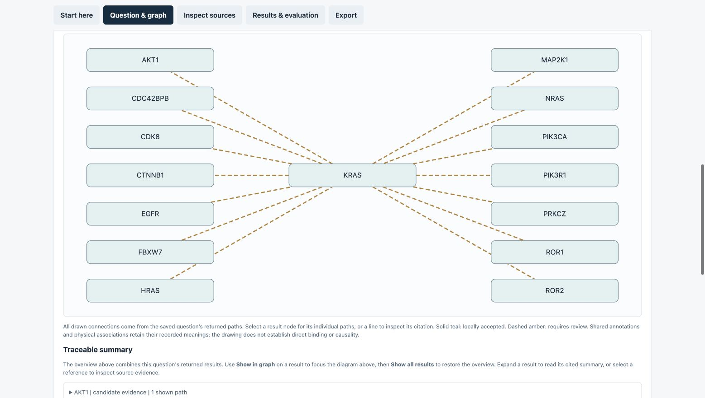
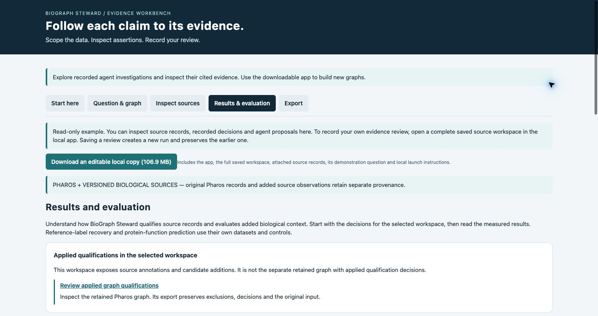

# How to use BioGraph Steward

Use BioGraph Steward to follow a biological question to its graph, inspect the
supporting source records, and share a result someone else can check.
The real-data example covers **99 primary human protein targets** from a captured
Pharos cohort. One application offers two saved examples: **Added source
context workspace**, with additional qualified association and location data,
and **Qualified Pharos workspace**, with applied identifier decisions. Each
preserves its own input. The larger historical function-prediction study is a
separate assessment, not another version of these app graphs.
These are frozen research workspaces; [source dates](docs/SOURCE_NOTES.md#current-reviewer-graph-and-source-dates)
are recorded separately from the date the app was updated.

**[Open the public demo](https://bi-3a117d5e2b3942678dc518fce65ab5d2.ecs.us-east-2.on.aws/?run=native_evidence_workspace_20261115&question=native_physical_KRAS_question_v3_20261115&agent_job=source_agent_eval_dc7b597201da_S01&view=data)**
directly. No sign-in, AWS account, installation or running model is needed. Prefer to watch first? Use the
[narrated walkthrough](output/walkthrough/BioGraph_Steward_Walkthrough.mp4)
or its [transcript](output/walkthrough/BioGraph_Steward_Walkthrough.txt).

The shared site replays actual completed agent work and checks its saved sources.
It does not make new model calls, retrieve new data or apply review edits. New
questions can be run in an authorized [operator installation](docs/SOURCE_AGENT.md#operator-cli).

## 1. Open the recorded question

[Open the recorded KRAS example directly](https://bi-3a117d5e2b3942678dc518fce65ab5d2.ecs.us-east-2.on.aws/?run=native_evidence_workspace_20261115&question=native_physical_KRAS_question_v3_20261115&agent_job=source_agent_eval_dc7b597201da_S01&view=data).

In **Start here → Agent workflow**, use the designated recorded KRAS run.
If it is not already open, expand **Open a recorded agent run**, select the
verified KRAS model record and choose **Replay the recorded run**.
Allow the recorded run to finish loading before continuing; the app checks its
saved sources before displaying the result.
A spinner and message identify what is loading. If a load fails, the spinner
stops and the error stays visible.

The question asks which proteins in the saved cohort have physical-association
records with **KRAS**. KRAS is the protein at the centre of this example; the
answer covers the selected workspace rather than every protein in biology.

## 2. Follow the four agent steps

Use the numbered step tabs, or each **Continue** button.

| Step | What to inspect | What you should learn |
|---|---|---|
| **1. Question & plan** | The question, KRAS identity, native physical source and limit of eight results. | The model proposed a source query that the app checked before executing. |
| **2. Evidence graph** | The graph and cited answer. Find **CDC42BPB**. | Eight of 14 matching partners are displayed under this run's limit. The separate manual KRAS answer displays all 14. |
| **3. Source inspection** | Expand **Inspected citation [E002]**, then **Native physical source coverage and identity**. | This KRAS–CDC42BPB source pair was absent from the captured baseline. |
| **4. Review proposals** | The proposal linked to E002. | **Retain candidate context** keeps the record available for review; it does not accept the claim or change the graph. |

For E002, find **baseline pair present: false** and
**integration state: new_workspace_pair**. This is one of **87** qualified
physical-association pairs absent from the captured Pharos graph. It is an
addition to this saved evidence collection, rather than a newly discovered
biological interaction.

The same source passport preserves **STRING 12.5**, its score of **203/1000**,
and protein-identity checks. Physical association can mean proximity or a shared
protein complex; it does not establish direct binding. A provider score is not
a measured probability that the biological claim is true.

For more detail, use **All returned source citations → Inspect this claim
manually**. The model prioritized three citations, but all eight returned results
remain available. Every source assertion grouped under a selected citation was
inspected; complete technical details are available in the disclosures.

In the separate **Question & graph**, the default overview combines the
question's returned results. The saved manual KRAS answer shows all 14 matching
partners. Use **Graph view** or **Show in graph** on a summary result for its
individual evidence paths. **Show all results** restores the overview.
Expanding summary text opens its explanation without changing the selection.

The question overview is one view of the underlying workspace. **Browse saved
workspace** opens its bounded graph and complete record tables under **Inspect
sources**. The workspace has 9,724 entities and 19,310 evidence records. Drawing
limits keep the display readable; the tables, searches and exports retain the
complete data.

### Explore connected paths

Open **Question & graph → Explore paths in this saved graph**. Start with one
of its example buttons. These examples use the native KRAS workspace:

| Start → end | Recorded relationship | Maximum connections |
|---|---|---|
| **KRAS → CDC42BPB** | Interaction annotation | **1** |
| **TP53 → nucleus** | Native GO location annotation | **1** |
| **BRAF → ARMS-mediated activation** | Pathway membership | **1** |

For your own query, type a name or accession under **Find a start entity** and
choose its exact entry. Starts are sorted with proteins first and must have
outgoing evidence under the selected filters. **Find a reachable end entity**
filters the endpoint suggestions separately. Leave the end open to see paths
from the start, or select one suggested endpoint and choose **Explore saved paths**.

Use **Candidates and accepted** to inspect this example's unreviewed evidence.
**Accepted locally only** can be empty because acceptance requires a recorded
review. The form explains that state instead of silently broadening the query.
Reachability follows saved direction and explicitly symmetric records, with
the displayed connection and search limits. An annotation path is recorded
context rather than a biological mechanism. A missing path under these filters
does not establish biological absence.

## 3. Understand the results and evaluation

[Open the qualified TP53 example directly](https://bi-3a117d5e2b3942678dc518fce65ab5d2.ecs.us-east-2.on.aws/?run=source_faithful_workspace_20261113&question=question_20261113T075313Z_1a76b00f&view=ask).

Return to **Start here** and choose **Review applied graph qualifications**.
This opens **Qualified Pharos workspace** and its matched retained TP53 example.
Its input differs from **Added source context workspace**, used by KRAS; their
total record counts are not a paired before/after comparison. Open **Results & evaluation**.
The page heading is **Results and evaluation**. It explains how source records
are qualified and how added biological context is assessed, without requiring
familiarity with earlier app versions. Start with the selected workspace's
decisions, then read the separate scientific comparisons.

- **Applied qualification:** 16,985 input records become **16,687 retained**.
  The **298 exclusions use obsolete Gene Ontology identifiers**. Original
  records and reasons are preserved; unresolved records stay retained.
- **Location-reference comparison:** only **31 of the 99 targets** match the
  published human location benchmark, supplying **51 known protein-location
  labels**. Captured Pharos recovers **41/51**, and the native GO view recovers
  **44/51** under the same ontology mapping. The other 68 targets lack a matching
  reference label. Some annotations and the reference reuse Human Protein Atlas
  observations, so agreement is not fully independent experimental support.
  The previously used OpenCell imaging reference changes **30/40 to 31/40**
  labels among **23 matched targets**, after the stated source exclusions.

Read the whole comparison table, including its controls. These measurements
show known-label recovery under defined source views; shared sources and prior
reference use limit independence. The separate, larger
[protein-function prediction study](docs/evaluations/CONTEXTUAL_COMBINATION_RESULTS_20261115.md)
has its own historical graph, methods and comparisons. Its primary
timepoint-ontology view precedes the fixed-starting-ontology sensitivity check.
Ordinary micro-Fmax summarizes the precision–recall balance over protein–GO
decisions; it is not percentage accuracy or the recorded agent's score. Neither
location benchmark is a verification step executed for every app question.

A diagram is a focused answer, not the complete workspace. For example, the
native workspace contains **9,724 entities and 19,310 evidence records**;
the displayed KRAS graph selects only the records relevant to that question.

## 4. Download the result you need

| Public demo download | What it contains |
|---|---|
| **Download an editable local copy** | The complete native KRAS workspace ZIP: app, full saved graph, attached source records, saved KRAS question, recorded agent job and local launcher. Use this to record your own evidence reviews. The download size is shown before you choose it. |
| **Download this verified agent record** | The question, focused graph, model/tool trace, source inspections and review proposals. This smaller inspection record is not the complete editable workspace. |

The complete-copy button appears beside the native workspace's read-only notice
and under **Export** after the prepared package verifies. It copies the full
99-target saved workspace, not only the small answer diagram. It does not copy
cloud accounts, the Neptune mirror, hosted assessment pages or optional global
GO/QC inspector data.

In **Qualified Pharos workspace**, open **Export** to read how its full graph,
decision ledger and original input relate. The private final data ZIP includes
these graph and ledger inspection exports, alongside the exact primary
Pharos-only comparator. They are separate from public-demo downloads.

The separate full Qualified Pharos source-recovery package includes `source_retained_package`:
`retained_graph.json` is the resulting graph, `edge_dispositions.jsonl` holds
each input record's decision and reason, and `baseline_packet` holds the original
graph and sources. An undecided record remains retained. The native KRAS package
contains its candidate graph and sources; it does not include the separate TP53
qualification decisions.

The focused answer ZIP, complete saved-workspace ZIP and graph/ledger inspection
package serve different purposes. The [five-item final folder](docs/DELIVERY.md#final-submission-folder)
contains a private **BioGraph_Steward_App_Data_and_Exports.zip**, combining the
complete KRAS app/source copy with graph, decision-ledger and matched-baseline
inspection exports. The full Qualified Pharos source-recovery packet is a
separate optional replay asset. Source terms apply to this organizer handoff.
A public agent record does not silently contain a complete source workspace.

## 5. Continue with the same graph locally

The shared site remains read-only. Downloading a local copy lets you record your
own evidence decisions without changing that shared example.

1. Open the native KRAS example. Choose **Download an editable local copy**
   beside the read-only notice or under **Export**. The button shows the ZIP size.
2. Extract it into a new empty folder and read **OPEN_WORKSPACE.txt**. Keep its
   source folders intact. Allow disk space for the extracted workspace and the
   new reviewed run.
3. With Python 3.10 or newer, run `python3 START_EDITABLE_LOCAL.py` from the
   extracted folder. The launcher chooses a free port on your own computer,
   opens the saved KRAS question in your browser and prints the address.
   No model, GPU, AWS account, package installation or new data retrieval is needed.
4. Under **Inspect sources**, select a claim and choose **Guide me through this
   source**. Read the source record and its recorded conditions. Choose
   **Record evidence review**, then enter **Reviewer**, **Decision** and
   **Reason and evidence reviewed**.
5. Choose **Save review in a new run**. The app opens your reviewed copy and
   supplies **Open the earlier run**. The earlier graph, source files and review
   history stay unchanged. The new run is saved inside the package's `runs` folder.

Local editing means recording evidence-review decisions and reasons. It is not
a general-purpose node-and-edge drawing editor. For a software demonstration,
use **provisional** with a reason saying that the claim still needs scientific
review. A local decision records your judgment rather than creating an
independent biological benchmark label. Stop the local app with Ctrl+C.

Applied retained-graph views stay read-only. The native KRAS copy does not
include the separate TP53 decisions or Pharos-only comparator. The submission
graph-and-decision archives remain separate. See the
[copy verification and scope](docs/evaluations/editable_demo_copy_20261117/README.md).

If Chrome reports **Blocked by your organization**, follow your organization's
approved process for downloading software archives. Managed browsers can block
website downloads through [Chrome Enterprise policies](https://support.google.com/chrome/a/answer/7579271?hl=en).
The website cannot override that policy.

## Use another supported question or construct a cohort

Recorded examples also cover EGFR physical associations, TP53 locations and BRAF
archived pathway context. For BRAF, first open **Review applied graph
qualifications**, then choose its recorded run in that retained workspace.
Select an available recorded run; its attached source tools determine what can
be answered. **Candidate** means available for review;
**accepted** means explicitly accepted in the local review state. An empty
accepted-only answer does not mean there is no biological evidence.

New questions and new data belong in a local or operator installation:

- **Construct a new cohort:** follow the
  [graph-building instructions](docs/CONSTRUCTION.md#build-through-the-app).
  Supply an explicit list of 1–25 proteins per request to build a Pharos graph
  with a cited answer. This is an interactive request limit, not a limit on
  saved-graph size. It needs internet access and no model or GPU.
- **Run a new agent question:** follow the
  [source-agent instructions](docs/SOURCE_AGENT.md#operator-cli). Supply a
  complete source workspace and configure a model endpoint. The agent can use
  the source tools actually attached to that workspace.

The public demo keeps its saved data and decisions fixed. It provides the same
inspection workflow without executing these new-run operations.

## Open the portable APP location example

The separately supplied **`BioGraph_Steward_APP_PSEN_Example.zip`** contains a
complete real-source example for APP, PSEN1 and PSEN2. These proteins are outside
the original 99-target cohort. It is a local packet, not an additional workspace
on the public site.

1. Extract it into a new empty directory. Keep the supplied `runs` folder names.
2. Follow **OPEN_EXAMPLE.txt** to start its included runtime with Python 3.10+.
   Saved replay needs no installation, model, token, AWS account or network.
3. Open its exact **APP location-agent** link. Follow the same four step tabs.
   The recorded query displays 10 of 24 matching location concepts. The complete
   24-concept answer and its 75 source rows are also preserved in the packet.

This new three-protein Pharos capture is dated November 17 UTC. Its candidate
source additions and unapplied review proposals remain separate from the
original graph's qualification decisions. The [worked-example results](docs/evaluations/GENERALIZATION_EXAMPLE_20261117.md)
explain the source versions, complete replay and unchanged comparison rules.
Its optional `START_EDITABLE_LOCAL.py` supports the same
[local review workflow](#5-continue-with-the-same-graph-locally).

The [project report PDF](output/pdf/BioGraph_Steward_Final_Report.pdf)
([Word copy](output/docx/BioGraph_Steward_Final_Report.docx)) explains the
approach, measured improvements and opportunities for broader validation.
