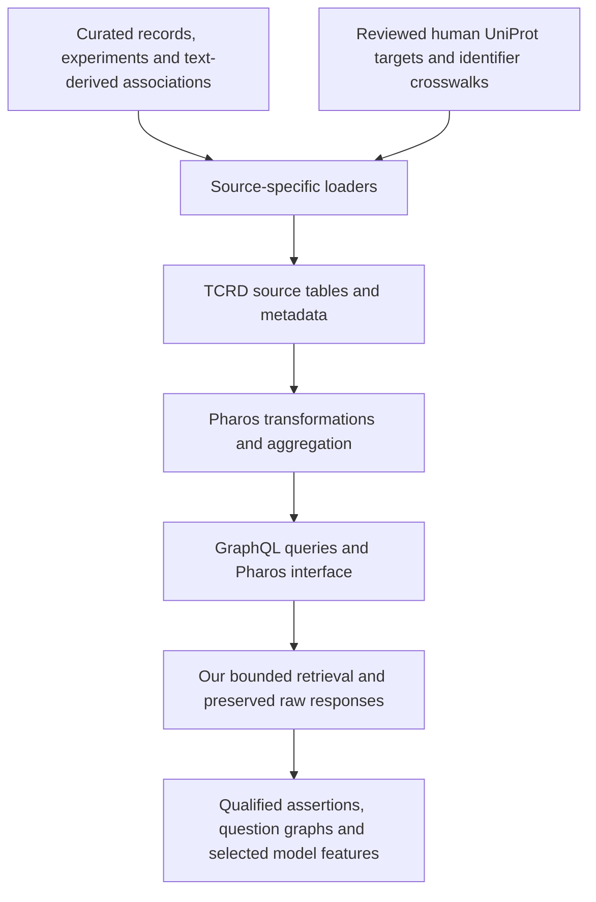

# What BioGraph Steward should add to Pharos

**Repository scope note (October 22):** this is a dated source/methods review. Its historical observations remain useful; the [current build plan](BUILD_PLAN.md) supersedes old next-step proposals. Closed study implementations and reports are preserved in the [experiment archive](EXPERIMENT_HISTORY.md).

Decision review: October 20, 2026. Based on the supplied proposal/challenge, official papers and public build/query code, and our saved Pharos inputs. The [construction audit](evaluations/PHAROS_CONSTRUCTION_AUDIT_20261020.md) and [current representation audit](evaluations/PHAROS_CURRENT_REPRESENTATION_20261020.md) contain the source identities, observed counts and reproducible checks. This review adds no biomedical retrieval, model calls or biological performance results.

## Decision

Use Pharos as a rich starting resource. Prioritize understanding the context and origin of its records, then integrate only the detail needed for a specific CRC question. Further generic clinical-abstract extraction trials are deferred: their failures diagnose one ingestion component, but do not establish the most valuable contribution to this product.

The immediate product increment should compare evidence across snapshots and preserve traceable review decisions where the evidence and review basis are unchanged. The next biological enrichment should deepen our existing CIViC/CPTAC integrations, subject to record-level overlap checks and a declared endpoint. These have different success criteria: maintenance utility does not establish predictive improvement.

## How Pharos is constructed

The [official TCRD build overview](https://github.com/unmtransinfo/TCRD/blob/90d072154fa7afa1eca3dc3449dae709c72cf1b6/README.md) describes UniProt-first identity anchoring and separate source loaders. Pharos is consequently a target-centric integration system with heterogeneous observations, rather than one uniformly measured experimental graph. The public builder is historical; current transformation instructions delegate work to another repository whose contents we could not verify. A reported `pharos319` version does not attest a public code commit or equal freshness across all sources.

Three distinctions affect interpretation:

- Disease queries can aggregate child-disease associations through Mondo. Broad CRC membership does not imply an exact subtype or variant-specific therapy effect. This behavior and historical mapping gaps are documented in [Pharos 2023](https://doi.org/10.1093/nar/gkac1033).
- One PPI record can combine several provider labels. STRING scores and BioPlex probabilities describe different quantities; the provider count is not an independent-experiment count. In our saved KRAS probe, `/target/ppis/1` links KRAS to BRAF and carries `BioPlex,Reactome,STRINGDB` together.
- Stored data, API views and our selected features differ. The historical [Harmonizome loader](https://github.com/unmtransinfo/TCRD/blob/90d072154fa7afa1eca3dc3449dae709c72cf1b6/loaders/load-Harmonizome.py) stores gene-set associations, whereas the inspected GraphQL view exposes counts/CDF summaries. Missing detail in our view does not establish absence from TCRD.

Pharos also already provides subset analysis, enrichment and visualizations. Our contribution must be assessed against those existing capabilities.

## Our retrieval is no longer the small starter

The matched panel covers 512 genes, with 512 of 513 requested protein products resolved. It scanned **419,049 records**: 12,421 pathways, 8,403 GO annotations, 81,787 interactions and 316,438 expression observations. Declared scope retained 30,058 rows; excluded neighbor/tissue rows remain in the raw responses. Requested families reconciled their API counts. Drug and publication discovery were deliberately omitted from this experimental profile.

The remaining boundaries concern meaning and granularity. Retrieved GO fields omit relation/negation/extensions and claim-level references. Interaction bundles lack sufficient experiment-level lineage. Expression observations have unknown units and no populated publication/URL fields. All 512 products link to LinkedOmicsKB, which does not establish possession of all underlying CPTAC measurements. Conservative feature exclusions are separate from ingestion: excluded GO and other source records remain preserved.

The ordinary disease workbench and this explicit-ID experimental panel are different artifacts. The historical 99-protein/806-pathway starter must not be presented as the current baseline.

## Which integration could make a difference?

| Candidate | Specific added value to investigate | Current status and limit |
|---|---|---|
| CIViC qualified response evidence | Complete molecular profile, therapy set, disease, direction, significance and citation for the proposed KRAS/anti-EGFR question | Already implemented. Deepen study/context inspection and overlap accounting before expanding scope. This is added qualified detail, not proven independent evidence. |
| CPTAC COAD measurements and context | Sample-level protein/phosphosite measurements, assay and mutation/phenotype context beyond a protein link or across-sample summary | The complete 6,422-gene × 96-sample protein matrix is preserved; the pilot used descriptive gene summaries. Sample/genotype-conditioned analysis and phosphosite integration are not yet established. |
| Upstream GO/PPI record details | Recover references, experimental system and qualifications missing from our retrieved fields | First verify which details are accessible through Pharos, then upstream. This improves interpretation of existing evidence; it need not add a new experiment. |
| Reactome reaction/complex topology | Specific participants, direction and complex structure beyond membership | Conditional on a question requiring these relations. Reimporting pathway memberships would duplicate existing representation. |
| Another broad KG or generic literature extraction | Potential missing relations | Deferred until a bounded evidence gap is demonstrated. More edges or successfully formatted output would not establish value. |

The [CIViC evidence model](https://docs.civicdb.org/en/latest/model/evidence/overview.html) already supplies structured clinical qualifications. [LinkedOmicsKB COAD downloads](https://kb.linkedomics.org/download) list tumor/normal protein and phosphosite data; its [manual](https://kb.linkedomics.org/manual) describes mutation/phenotype and site-level analyses. These establish available types, not completed imports or causal relationships. PDC and LinkedOmics deliveries of the same experiment remain one origin.

For each addition, compare source-record identity, qualified claim and underlying study/sample separately. Report duplicates, additional detail, changed records, conflicts or unresolved overlap. A different database name or PMID does not establish experimental independence.

## A concrete next product increment

Within-run source-record → evidence-edge → assertion links already exist. The verified gap is **cross-snapshot comparison and review reconciliation**: changing only snapshot creation time leaves assertion IDs and evidence revisions unchanged, but currently rejects all old reviews.

Build one comparison on an existing focused question graph. Show unchanged, changed, added, comparable removals and non-comparable absences; identify affected assertions using the existing links. Preserve original snapshots/events. Propose review carryover only when evidence, context, mapping, transformation and review policy remain compatible, with explicit provenance in the new run. Never interpret a capped, failed or differently scoped query as a withdrawal, or a source-record disappearance as scientific retraction.

Use established source-chain fields from [Biolink RetrievalSource](https://biolink.github.io/biolink-model/RetrievalSource/) and derivation/revision concepts from [PROV-O](https://www.w3.org/TR/prov-o/). Do not invent study IDs or populate an independence count from provider labels. Controlled refresh cases should recover every affected assertion, avoid unaffected invalidations and false withdrawals, and preserve eligible unchanged reviews. These are proposed acceptance criteria, not achieved results.

## How to establish biological value

Our fresh growth-ranking comparison established no primary gain. Pharos+CPTAC's secondary correlation increased, but MAE worsened and Recall@10 did not improve. Those consumed holdouts remain development history. The clinical extraction comparison's 0/22 qualified associations concerns another component and endpoint.

The challenge's same-model baseline-versus-enriched **held-out graph-link** comparison remains pending. Use an organizer-assigned experimental task if supplied; none has been identified in this review. Otherwise document an appropriate measured relationship task before choosing another enrichment. Freeze the endpoint, candidate population, source-overlap exclusions and split before fitting. Keep related studies/samples and equivalent assertions together, remove held-out facts from both graphs/features, and compare with the same model and budget plus coverage/degree controls. Missing associations are unlabeled, not measured negatives.

The challenge-linked [OptimusKG paper, v3](https://arxiv.org/html/2604.27269v3) provides a useful construction precedent: immutable source artifacts, typed metadata and inspectable transformations. Its literature-support evaluation also illustrates a limitation relevant here: experimental records may lack discoverable narrative support. Literature-search failure must therefore remain an uncertainty flag, rather than an automatic reason to prune an experimental edge. Its full graph has not been imported or evaluated in this project.

The two reviewable outcomes are a maintained, traceable CRC question graph and a separately justified biological comparison. Neither should borrow the other's success claim.
