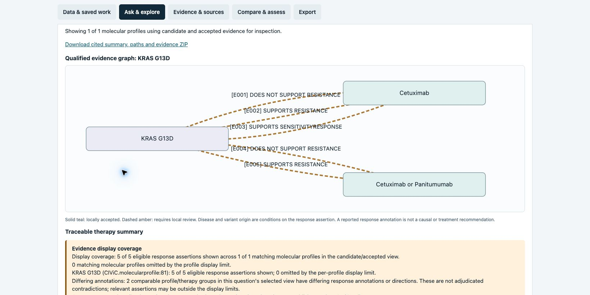

# AWS and Neptune deployment assessment — 2026-11-11

Release **`e4690bd`** deploys BioGraph Steward through the existing artifact
workflow to a private AWS workbench and a real Neptune Database. This checkpoint
tests source fidelity, access control, persistence and recovery. It does not
establish biological accuracy or improvement over Pharos. Configuration and
reproduction guidance: [Neptune deployment](../../deploy/aws/NEPTUNE.md).

The live test uses Ohio (`us-east-2`), a `t3.large` application host and two
`db.r6g.large` database instances running Neptune **1.4.8.0**. Access uses private
Session Manager forwarding; HTTP, SSH and the database have no public ingress.

The frozen biological source contains **9,746 nodes, 15,717 edges and 15,712
assertions**, covering **99 proteins in the scoped colorectal cohort**, with Pharos319 and
scoped CIViC candidate evidence. Neptune also stores ordered assertion, context
and review inventories, so its physical vertex count exceeds the biological
entity count.

| Check | Observed result |
|---|---|
| Deployment | Storage, workbench and Neptune CloudFormation stacks created; private IAM/TLS access, encrypted database, writer and reader in two AZs. |
| Initial import | Completed in **86 seconds**, with **zero reported errors or duplicates**. |
| Complete graph parity | All **34,823 Neptune vertices and 15,717 relationships** matched the saved projection, including preserved records, identifiers and endpoints. Database reconstruction reproduced the complete source graph digest below. |
| Scoped evidence inspection | The prepared question identifies **8 relevant evidence records**, **38 outside its scope**, and **2 discordance groups**. Five assertions passed the additional full-context parity check. These are scope/context checks, not accuracy labels. |
| Workspace access and persistence | Automated HTTP checks passed authentication, browser-origin handling, source guides and restart persistence. A harmless write query was rejected with **403** after import permissions were disabled. |
| Browser workflow | Chrome sign-in, live Neptune inspection, guided source explanation, exact question, graph, summary and source-passport navigation passed. The saved browser answer matches the complete frozen deterministic reference; no original graph or review state changed. |
| Workspace recovery | **191 workspace files** restored byte-identically; the recovered workspace reopened under the release image with network access disabled. |
| Database failover | Manual promotion from AZ **2b** to **2a** completed. Complete record parity, database reconstruction and scoped evidence parity passed again. A three-minute probe recorded 77 successful reads and 8 interrupted reads, with recovery observed about 16 seconds after the first failed probe. This sampled interval is not an availability guarantee. |
| Native snapshot recovery | Manual snapshot restored to a separate private, encrypted, IAM-enabled cluster. Complete record parity, database reconstruction and the scoped evidence answer passed on the restored database. The temporary instance, cluster and extra read permission were then removed. The original database, manual snapshot and versioned workspace backup remain available. |

Verified reconstructed graph SHA256:

```text
ec17705538a0f0d2166187e0fa0505ee3f78b05c5d7745c3a5e44460898ccfde
```

The ordinary app answers still use the authoritative saved workspace files.
The Neptune inspection card and acceptance runner make real database reads;
the mirror is bound to the complete frozen graph digest. Other workspaces or
new review states need their own verified projection before this card can read
them. This is not a complete migration of every app query to Neptune. The successful
checks establish faithful deployment and a traceable database mirror, rather
than new scientific evidence. The two-AZ database test does not establish full
application high availability or a production SLA.

The browser walkthrough used user-assisted sign-in and automated inspection;
it was not an independent colleague's usability or biological review. Unfiltered
profile inspection returned nine evidence records/six claims; applying the
cetuximab question scope selected eight records/five claims. The remaining
record describes panitumumab alone. All nine records remain in the frozen graph.
The [subsequent bounded Nemotron check](NEMOTRON_NEPTUNE_PLANNER_20261111.md)
abstained on the supported question; the deterministic workflow remains the
delivery path. The model result does not change the successful database checks.



The screenshot shows the guided question's saved-workspace graph. All five
claims remain candidates. Direct Neptune record inspection was verified
separately; this diagram is not evidence of scientific validation.

Private receipts remain in ignored local directories:

- `runs/aws_preflight_20261111/` — identity, plan and regional prerequisites.
- `runs/neptune_production_20261111/` — source release, import, security,
  persistence, reconstruction and recovery records.
- `runs/aws_pruning_preparation_20261111/` — frozen question, deterministic
  baseline, scope and disagreement worksheet.

These directories are not published with this assessment. Account identifiers,
database endpoints, IP addresses, credentials and private credit details are
excluded. Recovery-resource cleanup is verified in the private receipt. Biological
assessment proceeds against the frozen comparator without changing the
source or treating database success as scientific improvement.
