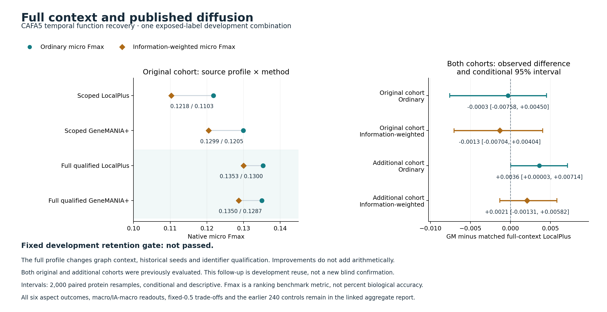

# Combining qualified context and reusable agent procedures

November 14, 2026. This round follows the
[completed reference assessments](SCIENTIFIC_RESULTS_20261114.md). Previous
scores, failed executions and exposure boundaries remain unchanged.

## Two questions, with separate outcomes

1. Does the unchanged published GeneMANIA+ predictor benefit from the full,
   strictly qualified historical Pharos network and training context?
2. Does a small reviewed source-search skill help the existing NVIDIA agent
   retrieve reference papers, compared with the same agent and tools without it?

The first combines two previously useful components. Their gains cannot be
added arithmetically. The combination is selected after the original PK/NK/LK
results, so its comparison is **development reuse of exposed reference data**,
not another independent or blind confirmation. The second is a literature
retrieval task. Finding a paper is not equivalent to verifying a biological
assertion or improving graph-edge precision.

## Reuse decisions

| Released resource | What fits | Boundary or problem found | Decision |
| --- | --- | --- | --- |
| Published GeneMANIA+ implementation | The same historical weighted graph, dated training terms and fixed native regularized-Laplacian method | The useful earlier method and context results came from different comparisons; their combination needs its own complete outcome table | Run one fixed combination; preserve original controls and unfavorable readouts |
| K-Dense Scientific Agent Skills, v2.72.0 | Narrow ontology-resolution, claim/evidence and evidence-appraisal procedures | Its paper reports documentation measurements, without task-level scientific evaluation; structural validators do not establish entailment | Stage selected MIT-licensed files for review; supply only a relevant bounded excerpt to the application agent |
| BioMCP, v0.9.3 | Explicit PubMed search with native source/query/status metadata | Default federated search and ordinary article-get can use additional providers; native HTTP-request counts are not fully exposed | Allow PubMed search only; reuse our existing exact-PMID PubMed fetch/parser |
| ToolUniverse, v1.5.10 | Some source adapters and research procedures are reusable | Reviewed PPI guidance uses the STRING experimental channel as physical-binding evidence; we require assay-level qualification before a direct-binding verdict. Its NumPy requirement also conflicts with the frozen numerical environment | Reuse only qualified components; do not import the complete skill collection or its evidence judgments |
| Biomni | Broad biomedical orchestration, including a local-model route and a separate PMID-preserving MCP example | Its legacy PubMed helper can broaden a query without returning the effective query or PMID; the separate native MCP example preserves identity. The full runtime was not qualified here | Keep the already qualified smaller retrieval surface; defer a second broad platform |
| GeneAgent | Database-guided verification and withholding a source from verifying its own labels | The 132 released human judgments concern the original verification decision, not raw claim truth; only ten gene-set clusters, with a strong always-correct control | Reuse the methodological lesson; keep a separate report-correctness assessment on hold |
| PathAnchor | Source-bound evidence paths and exact evidence opening | Published evaluation concerns flexible sensors, and much of the capability is already in our guided source/path inspection | Methodological support, not a new biomedical accuracy claim or framework replacement |
| NVIDIA Agent Skills and optional NeMo Agent Toolkit | Product-specific RAG/MCP development guidance and optional workflow instrumentation | The official toolkit documentation announces October 2026 deprecation and end-2026 EOL. That notice concerns the optional orchestration toolkit, not our independently served Nano model | Preserve the pinned optional wrapper for reproduction; add no new framework dependency or migration to this comparison |

The [versioned reuse qualification capsule](reusable_agent_tools_20261114_summary.json)
pins source files, commits, licenses and the distinction between documented
capabilities, locally demonstrated behavior and unresolved transfer. The
[official NVIDIA lifecycle notice](https://docs.nvidia.com/nemo/agent-toolkit/latest/index.html)
and [skills catalogue](https://github.com/NVIDIA/skills) were checked separately;
coding guidance is not a biological reference standard.

Skill files are procedures supplied as context, not new model weights. Installing
a skill in Codex alone does not connect it to the NVIDIA application agent.
Selected procedures must be explicitly bound to its available tools, context
budget and validation rules. Upstream installation commands and broad tool
permissions do not grant the application additional access.

## Controlled combination

The source network and training bytes are the same strict profile already used
by the saved LocalPlus inspector: 20,412 proteins and 985,863 native weighted
pairs. GeneMANIA+ retains the unchanged author equation and prediction defaults.
No fusion-weight search, new labels, thresholds or learned network weights are
introduced. This is the positive-only published predictor, not the GeneMANIA
web server's separate multi-network weight-learning workflow.

The complete existing 6,100-protein PK union remains fixed. Original-cohort
comparisons include original GeneMANIA+ and full strict LocalPlus. The additional
4,806 targets are outside the original graph, so old-graph GeneMANIA+ is not a
meaningful reserve comparator. That slot must remain unsupported rather than
receiving invented zero predictions. The reserve comparison uses full strict
LocalPlus and the real fixed native controls. All aspects, macro/IA readouts,
fixed-cutoff trade-offs and paired BPO uncertainty remain visible.

An initial exact cross-runtime shared-score check stopped on roundoff-scale
differences before combined outcome scoring. Its code and partial output are
preserved. A separately pinned same-host replay checks the new execution's
shared target rows exactly; the original 547-target NK/LK forecasts and their
reported results are not replaced by this numerical replay.

### Completed biological comparison

The combination **did not pass the fixed retention rule**. The existing
full-context LocalPlus inspector remains the supported product configuration.
On the original cohort, combined GeneMANIA+ reaches BPO micro-Fmax 0.134997,
compared with 0.135290 for matched full strict LocalPlus. On the additional
cohort, its point estimate increases to 0.143568 versus 0.139966, but the
information-weighted gain remains uncertain.

| Matched comparison: combined GM minus full strict Local | Ordinary difference, 95% interval | IA difference, 95% interval |
| --- | ---: | ---: |
| Original cohort, BPO N=833; IA N=832 | −0.000292 [−0.007576, 0.004505] | −0.001323 [−0.007040, 0.004041] |
| Additional cohort, BPO N=2,826; IA N=2,825 | +0.003601 [0.000027, 0.007143] | +0.002069 [−0.001312, 0.005821] |

Both BPO macro readouts decline on both cohorts. Cellular-component micro
points improve by 0.021681 and 0.007629, with mixed macro results; molecular
function is mixed too. These secondary observations do not replace the failed
BPO gate with a newly selected winning aspect. The original-cohort four-cell
interaction is negative on both BPO readouts, supporting the narrower finding
that the two earlier gains do not add arithmetically in this development
comparison. The source profile changes qualification, seeds and graph context
together, so this is not a pure causal estimate of topology.

At fixed 0.5, the native evaluator omits five new cells with zero prediction
coverage; those missing precision/recall values remain null. The sixth cell has
very low recall. No acceptance cutoff follows from Fmax. All six new cells,
macro/IA/Smin readouts, operating-point trade-offs and the complete earlier
240-slot inventory remain in the
[sealed aggregate addendum](combined_development_20261114/report.html).
An additional automated recomputation reproduced every saved paired interval
and interaction from the frozen draws exactly. This is numerical verification of the same
comparison, not an independent biological replication.

## A different agent role

The source-search increment fills an actual missing capability: the existing
literature reader fetches exact PMIDs but does not discover papers. It provides
a free, bounded support-search option while the separate paid PaperQA3
comparison remains unexecuted. It does not claim to reproduce PaperQA3.

The planned public-reference comparison uses the original BioASQ11 author
release, with deterministic selection of 12 factoid and 12 list questions from
permitted question metadata. Previously exposed documentation examples and
publisher leads are excluded before selection. Expected documents and answers
are absent from selection/model payloads and are released for scoring only after
all three fixed prediction sets are sealed and reviewed. The reference is the
original author release on Zenodo, licensed CC-BY-2.5; a differently assembled
third-party mirror was not substituted. The streaming parser internally decodes
JSON events, but only question ID, body and type are retained before release.

Both agent conditions receive the same model, source tools and limits: two
searches, one abstract fetch and at most four model calls per question. Only the
reviewed procedural excerpt differs. Native direct-question search is a separate
cost-reported control. Source plans, query echoes, caches, errors, provider
availability and returned identifiers are preserved. A returned paper is a
retrieval candidate; an opened source and a supported assertion remain distinct.

Reference-document recall measures recovery of the authors' positive document
sets. Those sets are incomplete, so another returned paper is not automatically
irrelevant or biologically false. The comparison is a public historical
retrieval regression, not an official BioASQ score or model-unseen evaluation.

### Source and runtime qualification

BioMCP's default article workflow can contact OLS4 for optional keyword
suggestions even when its declared candidate source is PubMed. A manual query
outside the evaluation exposed that behavior. The published
`--disable-sources ols4` option suppresses it; `--source pubmed` fixes article
discovery, and our existing exact-PMID PubMed XML reader supplies the optional
abstract. The native query, JSON, errors and stderr remain captured. A zero
process exit is insufficient to call a search complete: the adapter checks the
native completeness and failure fields and preserves partial candidates.

The comparison uses the existing NVIDIA Nemotron Nano 8B v1 checkpoint and
vLLM 0.8.5 service. Both agent arms have the same JSON action schemas and model
settings. The installed server tokenizer counts each exact transformed chat
prompt before inference, with an 8,192-token conservative context cap and
1,200 output tokens reserved. A failed count or oversized context produces an
explicit retained outcome. Tool execution is limited to search and opening one
returned PMID; retrieved text grants no tool or graph-editing permission.

The separate unchanged ontology-helper probe also exposed a known OLS API
shape distinction: the term-detail route can flatten synonyms, whereas the
search route retains their scope. Its strict mode conservatively left the
ambiguous synonym unresolved and rejected an obsolete current term. We did
not reinterpret a loose synonym as exact equivalence, silently apply a
replacement, or alter historical ontology meanings. The versioned source
ontology remains authoritative for dated model labels.

## Explanations must match the predictor

LocalPlus's exact one-hop weight explanation cannot be applied to a global
diffusion score. A published solution already exists: seed contributions from
the regularized-Laplacian kernel. The relevant native functions match those in
our pinned predictor. Any retained global inspector must distinguish historical
annotation seeds from independent experiments, and diffusion influence from a
causal or direct-binding path. Numerical solve error must accompany the
decomposition; the LocalPlus bitwise/one-hop claim does not transfer.

The published equations were matched to the pinned predictor, and six small
synthetic systems matched an independent dense-inverse control. The real-graph
explanation job and app consumer were deliberately not added after the
combination failed its retention gate. This preserves a reusable method
qualification without expanding the delivered interface or importing a GPL
scientific runtime into the core app.

## Primary sources and released artifacts

- [FastSinkSource and fixed prediction baselines](https://doi.org/10.1093/bioinformatics/btaa885),
  [official code](https://github.com/Murali-group/multi-species-GOA-prediction).
- [Interpretable network propagation](https://doi.org/10.1093/gigascience/giab082),
  [official provenance code](https://github.com/Murali-group/SARS-CoV-2-network-analysis).
- [Scientific Agent Skills paper](https://arxiv.org/abs/2609.00065v2),
  [reviewed release](https://github.com/K-Dense-AI/scientific-agent-skills/tree/526ebce143bc326f44471554e33d66a19c840360).
- [BioMCP release](https://github.com/genomoncology/biomcp/releases/tag/v0.9.3),
  [source-bound workflow guidance](https://biomcp.org/how-to/guide-workflows/).
- [Original BioASQ11 data and license](https://zenodo.org/records/7655130).
- [GeneAgent primary paper](https://doi.org/10.1038/s41592-025-02748-6),
  [official code](https://github.com/ncbi-nlp/GeneAgent).
- [Tool-chain silent-failure audit](https://arxiv.org/abs/2609.26836v2),
  [PathAnchor](https://arxiv.org/abs/2609.38766).

The biological combination is complete. The source-search comparison and its
separately frozen controller-feedback follow-up await closed-forecast reference
assessment; no retrieval or skill-benefit result is asserted yet.
