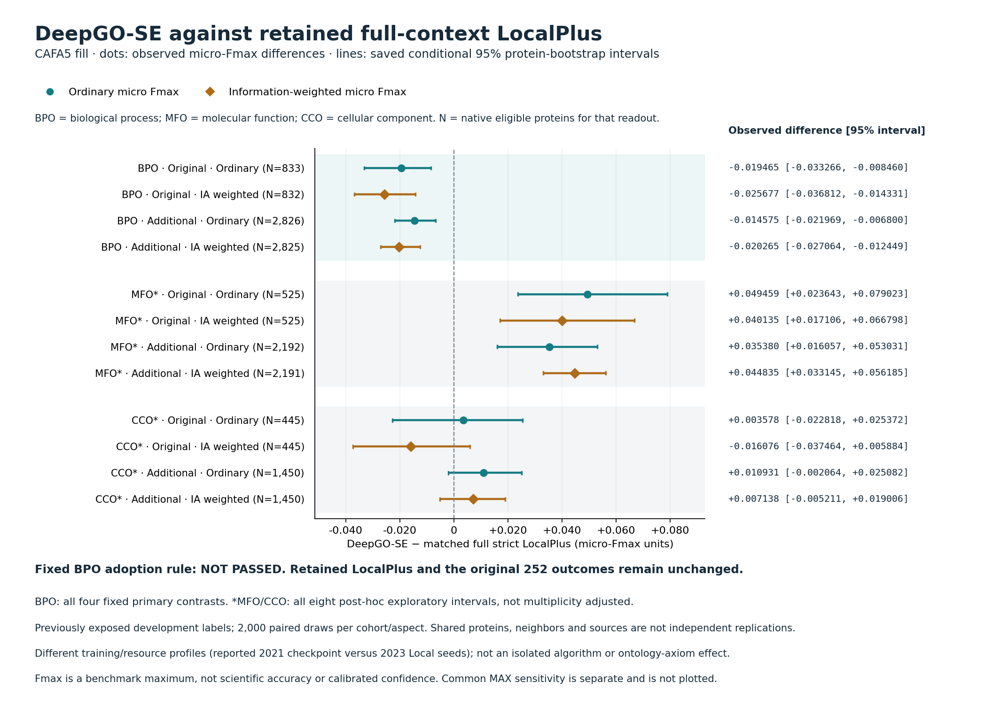

# DeepGO-SE: qualified sequence/ontology comparison

**The primary comparison is complete; the fixed adoption rule failed.** The
archived DeepGO-SE standalone-CLI-equivalent ensemble, evaluated with the supplied
CAFA5 `fill` recipe, had lower BPO Fmax than retained full
strict-source LocalPlus in both previously evaluated cohorts. All four paired
BPO intervals were negative. Molecular-function point estimates improved, while
cellular-component results were mixed. These secondary observations do not
replace the fixed BPO rule. The hosted LocalPlus profile remains unchanged and
no DeepGO product consumer is being added.

The separate, source-frozen common-`max` postprocessing sensitivity is complete:
all four BPO intervals also favor LocalPlus. It was launched before new primary
performance values were read and cannot replace this primary. All results here are **development evidence on reused,
already exposed CAFA5 annotations**, not independent confirmation or whole-graph
biological accuracy.



[Vector figure](deepgo_se_fill_figure_20261114/deepgo_fill_contrasts.svg) ·
[Complete primary and MAX report](deepgo_se_20261114/report.html) ·
[All eight exploratory secondary intervals](deepgo_se_secondary_20261114/secondary_uncertainty.html)

## Method and intended contribution

[DeepGO-SE](https://doi.org/10.1038/s42256-024-00795-w) combines protein-language
representations with Gene Ontology/GO-Plus axioms. We reuse its published
sequence/ontology predictor rather than train a new model or reconstruct the
separate graph-attention pipeline. The tested profile is an optional specialist
predictor, not an autonomous curator or a source of automatically accepted facts.

The executable source is the immutable
[author v1.0.0 archive, Zenodo 10369694](https://doi.org/10.5281/zenodo.10369694),
whose source folder identifies commit `46f346f`. The
[official repository](https://github.com/bio-ontology-research-group/deepgo2)
and its issues were used to qualify packaging and runtime problems. Current
repository code is not silently substituted for that archived predictor.

The paper describes Swiss-Prot 2021_04 supervision and a 2021-11-16 ontology.
The actual supplied `go.obo` header confirms `releases/2021-11-16`.
neXtProt 2023-04-18 is a paper evaluation resource; its date alone does not imply
that the checkpoint trained on future labels. We have not opened that reference
or reconstructed every checkpoint training row. Published preprocessing admits
TAS/IC alongside experimental/high-throughput codes, so “curated annotation
recovery” is more accurate than calling every label a direct experiment.

## Qualified inputs

The model-data record is [Zenodo 10369249](https://doi.org/10.5281/zenodo.10369249).
A maintainer confirmed that its immutable CCO directory contains BPO models and
provided a [corrected CCO archive](https://github.com/bio-ontology-research-group/deepgo2/issues/16#issuecomment-6435122743).
We preserve both archives and use the correction only for CCO. Tensor dimensions
alone cannot establish namespace identity.

| Artifact | Bytes | Publisher MD5 |
| --- | ---: | --- |
| Author v1.0.0 code ZIP |63,263|`750f8637d821892d0abf3155f22c3cda`|
| Published `data.tar.gz` |15,046,938,364|`5b5d0c25945cff446056ad4b3cd14b71`|
| Maintainer `deepgo2-cc-models.tar.gz` |5,005,426,061|`7cd657e30704141360b7bad1ed5b77a3`|
| Official Swiss-Prot 2023_03 archive |1,601,187,312|`11e3f6e03ad6ee60219974e2ddb0cd54`|

Observed SHA-256 values bind the acquired bytes:

```text
code ZIP       9a21cd0ffed48a24a5779187626ccddc15a54e4d7db2ac0753d785066c37840e
model archive  03c4ad26cb58a46e7617f9f3bbf56d5d8566ff3006f393a0d33c4cca56e092c2
CC correction  fe23e403e2529fc6c24982bb9d7b8a86de9d6d0450f10610cb9a34b4bb320dd2
Swiss-Prot     99a3e8f65092243596f21697f8cc406e271c3cb4c2cd9bd6cd085aef46ac005a
```

The model archive was acquired from the
[maintainer's relocated server](https://bio2vec.net/data/deepgo/deepgo2/data.tar.gz)
and matched the immutable record's exact byte count and MD5. The correction is
available at the [maintainer's published URL](https://bio2vec.net/data/deepgo/deepgo2/deepgo2-cc-models.tar.gz).
The original Zenodo access failures remain in the operator record.

Sequences come from the
[official UniProt 2023_03 archive](https://ftp.uniprot.org/pub/databases/uniprot/previous_releases/release-2023_03/knowledgebase/uniprot_sprot-only2023_03.tar.gz),
released 2023-06-28. Only its canonical `uniprot_sprot.fasta.gz` member was
selected: 91,753,753 bytes, SHA-256
`cab2d5a0f2bedd1923e675ccaebb5ad58c559024509e3208b074abf355d8a347`.
No current-sequence fallback, variant FASTA, DAT/XML annotations or author test
labels were selected.

The exact native [fair-esm 2.0.0](https://pypi.org/project/fair-esm/2.0.0/)
loader requires two local files, even when contact predictions are disabled:

| Official file | Bytes | Observed SHA-256 |
| --- | ---: | --- |
| [ESM2 3B checkpoint](https://dl.fbaipublicfiles.com/fair-esm/models/esm2_t36_3B_UR50D.pt) |5,678,116,398|`7de8b4082ba15891959ab368b77ce3886697af1efb16d3c9e9e7b0c5d3f07500`|
| [Contact-regression checkpoint](https://dl.fbaipublicfiles.com/fair-esm/regression/esm2_t36_3B_UR50D-contact-regression.pt) |6,759|`4da500eab246481dc9c8c95bc7b1d02f2803d761c380b0e95186d4a07d0fc84e`|

For these ESM files, the publisher URL and byte count were qualified; no reviewed
independent publisher content checksum was available. These SHA-256 values are
honestly recorded first-acquisition pins. A converted Hugging Face checkpoint
was not substituted.

The archived code license is BSD-3-Clause; the Zenodo model-data metadata specifies
CC-BY 4.0 and fair-esm specifies MIT. No separate correction-specific license was
observed. Model weights and source datasets remain outside this repository;
their lineage is retained rather than treating them as newly redistributable
project code.

## Fixed prediction and runtime contract

All **6,100** exact existing target accessions have human canonical Swiss-Prot
sequences in the dated source: 1,294 original PK targets and 4,806 additional PK
targets. The internal key `reserved` identifies the latter cohort; its outcomes
were already exposed before this increment and are not a fresh holdout.

Native ESM extraction uses layer 36 mean residue representations with 2,560
features, 4,096-token batches and the first 1,022 residues. **770 proteins** exceed
that length; their truncation is retained and recorded. Accession-only inference
headers prevent whole-FASTA-header identifier errors. Native length batching can
reorder rows, so features are joined by exact accession.

| Aspect | Native output heads | Fixed model indices |
| --- | ---: | --- |
| Molecular function (MFO) |6,851|0,1,2,5,6,8|
| Biological process (BPO) |21,356|2,5,6,7,8,9|
| Cellular component (CCO) |2,829|1,3,4,5,6,7|

The author aspect order is MFO, CCO, BPO. Each six-model ensemble uses batch 32,
unchanged eval/no-grad forwards and sequential float32 summation/division.
`DeepGOModel`, the normal-form loader and ESM extractor are called from the
verified archived source. Imported `deepgo.*` module paths are checked.

Inference uses Linux x86_64/Python 3.10.12 with author-pinned Torch 2.0.1/CUDA 11.7,
fair-esm 2.0.0, NumPy 1.26.1, Pandas 1.5.0, SciPy 1.11.3 and BioPython 1.81. Two
runtime differences are explicit:

- Official PyPI CPU DGL 1.1.2 satisfies the unchanged top-level graph-layer import.
  The selected sequence class does not instantiate DGL graphs or GAT operations.
  The [versioned DGL source](https://github.com/dmlc/dgl/tree/d40a3c37e555ff8bc6d3f84426b42d286c2556a0)
  documents distinct CPU/CUDA builds and PyTorch backend support. This is not a
  CUDA-DGL or GAT replication claim.
- Unused build utility CMake 3.29.6 replaces malformed 3.27.7 wheel metadata.
  Failed 3.27.7 / 3.27.9 checks are preserved; no metadata rewriting or validator
  downgrade was used. The seven scientific versions remain unchanged, and the
  qualified runtime passes `pip check`.

The producer is bound to `cuda:0`, float32 defaults and the recorded runtime.
The language-model server is stopped only under a separate bounded lifecycle
operator that restores its original container/configuration. That operator is
infrastructure; it does not change prediction mathematics.

## Native verification and comparison contract

A real three-protein check reproduced the unchanged author's default CLI outputs
exactly after decompression:58 MFO, 81 CCO and 280 BPO rows at `>=0.1`, rounded to
three decimals. The CLI and adapter share a pinned native feature cache. This
is bounded presentation equivalence, not a claim of bitwise equality for every
unrounded matrix cell or of scientific correctness.

The adapter exports every raw cell before that presentation cutoff/rounding.
It does not calibrate scores, add current GOA features, replace the checkpoint's
ontology or tune an ensemble. The qualified inference archives contain no
compatible MLP or graph-model checkpoint control; neither is invented or
retrained. Consequently this comparison cannot isolate an axiom-only or PPI
contribution.

The actual forecast freeze is FILE SHA-256
`2b368a9aee239d5d1c5325a4d7c17ff159c40fa3cfe4768aac578adf126c36fd`.
The completed forecast manifest is FILE SHA-256
`bfe8000ee13cf77942706f7d8ac33215139d16ce30ecfe29be5905cb1f982019`.
All six expected outputs are present, and the original model service was restored
with unchanged configuration. The seven producer files remain unchanged through
technical execution retries.
The first lifecycle attempt stopped after valid parity because of a process
ownership observation; its failure and successful original-service restoration
are preserved separately from the passed model check.

Measurement reuses the unchanged native CAFA evaluator, ontology, IA,
known-at-t0 masks and full previously released reference frames. It uses the
earlier frozen evaluation runtime: Python 3.10.12, NumPy 1.26.4,
SciPy 1.13.1 and Pandas 2.2.3. Unrecognized/older model terms follow the existing
native parser; missing vocabulary does not shrink the reference denominator.

The supplied CAFA5 reference recipe explicitly prescribes `prop=fill`; that
primary remains fixed. The general evaluator also supports `max`, while the
released DeepGO saved-test path propagates individual model predictions and its
sequence CLI emits raw ensemble scores. A separate source-declared sensitivity
therefore applies the existing native `max` API to **both** unchanged DeepGO and
strict LocalPlus profiles, with the same ontology/masks/IA/TOI/runtime and grid.
All 12 sensitivity cells and four paired intervals form a
[completed separate appendix](deepgo_se_20261114/max_sensitivity.html);
they cannot replace the fill primary or rescue its adoption rule. The direction
of this effect was not assumed. Common max after raw ensemble averaging is not
claimed to reproduce every detail of the paper's older ontology or ensemble
evaluation route.

The fixed practical comparator is full strict-source LocalPlus. Its 2023 known
seeds and the checkpoint's reported 2021 supervision differ, so this tests a
useful model/resource profile, not a controlled isolated algorithm effect.
Prior training membership and homology disjointness were not row-reconstructed;
PK prediction does not imply previously unseen proteins.

All six cohort/aspect outcomes, micro/macro and IA readouts, Smin and fixed 0.5
precision/recall/F1/coverage are retained alongside all 246 earlier outcomes.
BPO uncertainty uses the existing native per-protein counts, point-curve
agreement gate and 2,000 shared paired draws with seed 20261113. The fixed
retention rule requires ordinary **and** IA BPO paired 95% lower difference
bounds above zero versus full strict LocalPlus in **both** cohorts. No favorable
aspect or threshold will replace a failed rule.

Fmax chooses a benchmark threshold, not a deployable confidence. Curator
annotation is incomplete, proteins share sources/studies, and absent annotations
are not comprehensive negative biology. These results will estimate bounded
annotation recovery; they cannot establish whole-graph biological truth.

## Completed primary fill results

The completed aggregate retains six new scored cells and all 246 earlier
outcomes, including controls and negative results. The
[sealed public summary](deepgo_se_fill_20261114_summary.json) contains every new
point metric, fixed-0.5 value and difference against the matched retained
LocalPlus profile. No protein–GO cases, raw forecasts or private operator paths
are included there.

The BPO results were:

| Cohort | Ordinary / IA eligible proteins | LocalPlus ordinary / IA micro-Fmax | DeepGO ordinary / IA micro-Fmax |
| --- | ---: | ---: | ---: |
| Original |833 / 832|0.135290 / 0.130017|0.115824 / 0.104340|
| Additional |2,826 / 2,825|0.139966 / 0.132677|0.125391 / 0.112412|

Shared 2,000-draw paired protein intervals for **DeepGO minus LocalPlus** were
−0.033266 to −0.008460 (original ordinary), −0.036812 to −0.014331
(original IA), −0.021969 to −0.006800 (additional ordinary), and −0.027064 to
−0.012449 (additional IA). None meets the predeclared positive-lower-bound rule.
Native count-derived point curves agree with the unchanged official point
calculation within 1.1×10⁻¹⁵, below the fixed 10⁻¹² gate. Independent review
reproduced all saved draw hashes, seeded multiplicities, score summaries and
paired intervals exactly. These are conditional protein-resampling intervals;
shared source/study dependence and reused-label exposure remain.

All three aspects remain visible. The following are **saved point differences**
(DeepGO minus LocalPlus), not bootstrap mean differences. Positive Fmax and
negative Smin differences are favorable. MFO/CCO entries are descriptive point
comparisons; no post-hoc aspect-specific adoption is made. The separate
exploratory secondary-uncertainty supplement below does not change that rule.

| Cohort / aspect | Δ micro-Fmax | Δ IA micro-Fmax | Δ macro-Fmax | Δ IA macro-Fmax | Δ Smin | Δ IA Smin |
| --- | ---: | ---: | ---: | ---: | ---: | ---: |
| Original / BPO |-0.019465|-0.025677|-0.009952|-0.015721|+0.115982|+0.107232|
| Original / MFO |+0.049459|+0.040135|+0.022640|+0.016257|+0.010539|-0.195939|
| Original / CCO |+0.003578|-0.016076|-0.018906|-0.017456|+0.278274|+0.285498|
| Additional / BPO |-0.014575|-0.020265|-0.006356|-0.012185|+0.111796|+0.107595|
| Additional / MFO |+0.035380|+0.044835|+0.015459|+0.015835|+0.025455|-0.102377|
| Additional / CCO |+0.010931|+0.007138|+0.018142|+0.012111|+0.145799|+0.229024|

MFO improves all four Fmax point readouts in both cohorts, while its unweighted
Smin is worse and IA Smin is better. CCO is mixed: the original cohort's slight
ordinary micro-Fmax improvement accompanies worse IA/macro Fmax and Smin; the
additional cohort has higher Fmax but worse Smin. This profile is not uniformly
better across aspects or metrics.

### Completed exploratory uncertainty for both secondary aspects

The separate [secondary appendix](deepgo_se_secondary_20261114/secondary_uncertainty.html),
[complete aggregate](deepgo_se_secondary_20261114/secondary_uncertainty.json) and
[reviewable Markdown insertion](deepgo_se_secondary_20261114/secondary_uncertainty.md)
retain **all eight** MFO/CCO paired intervals. All six fill point values had
already been observed before this supplement was specified: it is **post-hoc,
exploratory and not multiplicity adjusted**. Both aspects, both existing cohorts
and both readouts were included irrespective of direction.

Differences below are DeepGO minus full strict-source LocalPlus. These are
conditional paired protein intervals, not independent biological replications.

| Cohort | Aspect | Readout | Paired 95% interval | Bootstrap mean difference |
| --- | --- | --- | --- | ---: |
| Original | MFO | ordinary | [0.023643, 0.079023] | 0.050267 |
| Original | MFO | IA_weighted | [0.017106, 0.066798] | 0.040737 |
| Original | CCO | ordinary | [-0.022818, 0.025372] | 0.001633 |
| Original | CCO | IA_weighted | [-0.037464, 0.005884] | -0.016344 |
| Additional | MFO | ordinary | [0.016057, 0.053031] | 0.034823 |
| Additional | MFO | IA_weighted | [0.033145, 0.056185] | 0.044687 |
| Additional | CCO | ordinary | [-0.002064, 0.025082] | 0.011220 |
| Additional | CCO | IA_weighted | [-0.005211, 0.019006] | 0.006661 |

**The exploratory molecular-function annotation-recovery signal is positive in
both existing cohorts and both readouts:** all four MFO intervals exclude zero
in DeepGO's favor. All four CCO intervals cross zero. This supports describing a
bounded, aspect-specific development signal; it does not establish general
scientific accuracy, fresh-reference replication or a causal ontology-axiom
benefit.

The molecular-function trade-offs remain: fixed-0.5 PPV is lower (original
0.3852 → 0.1815; additional 0.3916 → 0.2095), while recall and F1 are higher.
MFO unweighted Smin is slightly worse in both cohorts, while IA-weighted Smin is
better. Scores are uncalibrated, so the same numeric cutoff is not a matched
precision rule. These results do not turn the predictor into accepted
annotations or authorize a favorable-aspect replacement for the failed BPO
adoption rule. LocalPlus remains the app default, and no DeepGO consumer is
implemented.

All eight native checks used the **same full joined forecasts** as the original
fill points and the unchanged all-namespace parser/count pipeline, with only
the count-loop namespace parameterized. Each matched pair used 2,000 shared
protein draws (seed 20261113). Both methods reproduced their saved point curves
within 1.2×10⁻¹⁵, below the unchanged 10⁻¹² gate. Reference eligibility stayed
525/525 and 445/445 (original MFO/CCO ordinary/IA), and 2,192/2,191 and
1,450/1,450 (additional MFO/CCO). No new labels, model, threshold rule or source
was selected.

Independent numerical review reproduced all 16 saved bootstrap score summaries
and all eight paired means, intervals and sign fractions exactly, and
regenerated all four seeded draw-file hashes. This review used saved aggregate
score vectors; the native point/count agreement checks above separately bind
them to the scored forecasts.

The source aggregate FILE SHA-256 is
`6a36c63f4eeb6a5aae803f09df2c588c58956f309ababd82a3f84e582f07aec9`;
the post-hoc source-freeze FILE SHA-256 is
`52a025d396ed7aeca7dff82ca593a0f39d74da663b4a04b6320bfeed2df39ed1`.
The original fill primary and separate MAX appendix remain unchanged.

### Fixed three-slot follow-up

The later [matched-budget comparison](DEEPGO_SHORTLIST_20261114.md) gives both
profiles up to three benchmark-qualified terms per protein/aspect, rather than
comparing different prediction counts. Its designated MFO supported-slot
difference is +0.008254 in the original cohort (95% interval −0.011429 to
+0.027937, crossing zero) and +0.020225 in the additional cohort (+0.010489 to
+0.030417). All four BPO/CCO intervals favor LocalPlus. Thus the positive MFO
Fmax signal does not establish a consistent top-three benefit across both
existing cohorts. Related-term/IA diagnostics and all six differences remain
visible; no reranking or favorable-aspect adoption follows.

The predeclared fixed score of 0.5 exposes a different trade-off. Entries below
are **LocalPlus → DeepGO**; scores are uncalibrated, and the same numerical
threshold need not mean the same precision across models.

| Cohort / aspect | PPV | Recall | F1 | Native coverage |
| --- | ---: | ---: | ---: | ---: |
| Original / BPO |0.3003 → 0.1459|0.0274 → 0.0568|0.0502 → 0.0818|0.3505 → 0.7215|
| Original / MFO |0.3852 → 0.1815|0.0287 → 0.1010|0.0534 → 0.1298|0.1390 → 0.4114|
| Original / CCO |0.3771 → 0.2309|0.1356 → 0.1085|0.1995 → 0.1477|0.4292 → 0.7506|
| Additional / BPO |0.3402 → 0.1617|0.0381 → 0.0805|0.0685 → 0.1075|0.3493 → 0.7718|
| Additional / MFO |0.3916 → 0.2095|0.0511 → 0.1324|0.0905 → 0.1623|0.2281 → 0.4713|
| Additional / CCO |0.4218 → 0.3182|0.1408 → 0.1584|0.2111 → 0.2115|0.4938 → 0.7745|

PPV is lower and coverage higher in all six cells. BPO/MFO fixed-0.5 recall and
F1 increase, original CCO recall/F1 decrease, and additional CCO F1 changes only
slightly. This operating-point observation does not rescue the failed Fmax
retention rule or establish calibrated deployment confidence.

This is a practical **model/resource profile** comparison. The checkpoint's
reported 2021 supervision and ontology differ from LocalPlus's 2023 curated
seeds; 770 native sequence truncations are present; and complete training-row
and homology overlap were not reconstructed. These documented limits are not
measured causes of the difference. We did not execute a matched MLP control,
retrain the checkpoint, run GAT or isolate GO-axiom contribution. The result
applies to this archived CLI-equivalent ensemble plus the common CAFA5 fill
contract, rather than establishing that DeepGO-SE fails in general or that a
particular architectural component caused the result.

The primary aggregate FILE SHA-256 is
`23164e2bb2d68a7275fd5c6caf150084797fd690194ff8a72135132a46990c9b`.
The public summary FILE SHA-256 is
`89de656cbed7b9fcb00bf43d2a646ef00e46ff1409f19c170b11220a6ae14d14`.

## Completed common-max sensitivity

The separate [MAX appendix](deepgo_se_20261114/max_sensitivity.html) and
[complete aggregate](deepgo_se_20261114/max_sensitivity.json) retain all 12
profile/cohort/aspect cells, four paired BPO intervals, Smin, fixed-0.5
trade-offs, native count agreement and source/runtime pins. The source and
execution recipes were frozen and the run launched before new fill-primary
performance values were read. Both frozen profiles received fresh MAX point
and count calculations; no fill contribution arrays were reused.

The following are saved native Fmax point summaries, with all eligible
reference denominators unchanged from the fill primary:

| Cohort / aspect | Profile | Ordinary micro | IA micro | Macro | IA macro |
| --- | --- | ---: | ---: | ---: | ---: |
| Original / BPO | DeepGO MAX |0.115155|0.105320|0.149318|0.140847|
| Original / BPO | LocalPlus MAX |0.135290|0.130017|0.157304|0.155505|
| Original / MFO | DeepGO MAX |0.165864|0.147916|0.157785|0.153179|
| Original / MFO | LocalPlus MAX |0.113131|0.100949|0.131063|0.132183|
| Original / CCO | DeepGO MAX |0.245808|0.163417|0.248182|0.213809|
| Original / CCO | LocalPlus MAX |0.242398|0.177783|0.265909|0.230617|
| Additional / BPO | DeepGO MAX |0.126307|0.113522|0.168306|0.158817|
| Additional / BPO | LocalPlus MAX |0.139966|0.132677|0.173955|0.169981|
| Additional / MFO | DeepGO MAX |0.186862|0.139514|0.158578|0.152362|
| Additional / MFO | LocalPlus MAX |0.145264|0.088689|0.138119|0.130735|
| Additional / CCO | DeepGO MAX |0.291787|0.197892|0.310497|0.257712|
| Additional / CCO | LocalPlus MAX |0.280260|0.188466|0.290540|0.242700|

All four MAX BPO paired intervals for **DeepGO minus LocalPlus** remain negative:

| Cohort | Readout | Paired 95% interval | Bootstrap mean difference |
| --- | --- | --- | ---: |
| Original | ordinary | [-0.033677, -0.008255] | -0.020665 |
| Original | IA_weighted | [-0.035892, -0.012829] | -0.024455 |
| Additional | ordinary | [-0.021337, -0.005916] | -0.013562 |
| Additional | IA_weighted | [-0.026372, -0.011291] | -0.018765 |

This common propagation choice **did not reverse the BPO ranking** for either
cohort or readout. The retained LocalPlus saved point summaries happen to equal
its fill summaries in this run; invariance was not assumed and both profiles
were recomputed. The result does not isolate the cause of DeepGO's deficit or
establish that propagation is irrelevant generally. Common 2023 MAX applied
after raw ensemble averaging is still distinct from max-per-model handling and
the older ontology used by the paper's saved-test path. No third variant or
new adoption rule is selected from these outcomes.

The MAX source aggregate FILE SHA-256 is
`4dfdfe058aae629c45f3b0201f68489d50fc84a966e3c4c0d2359b5da95b882f`.
Its source/execution freeze FILE hashes are
`6135800783b2d64d147038efd3401c80b82edb6dc657950b156fafe06a1a7f01`
and `e60837ca12e18134672184ed17f2c570f9387ccdf6bfdb15bab1f12dd6bc23b6`.
The original 252 fill outcomes and failed four-interval retention rule remain
unchanged. No DeepGO consumer or default-profile change is made.

## Reproduction entry points and status

The optional [package README](../../tools/deepgo_reference/README.md) describes
archive selection, source-bound model assembly, dated sequence staging, the
committed [input skeleton](../../tools/deepgo_reference/INPUTS.example.json),
freeze/parity/prediction commands and the separate evaluator. Large acquired
inputs, model outputs and task-local lifecycle receipts remain on compute;
compact aggregate results can be returned for review.

Source-only operational captures are preserved in local archival Git refs:
`codex/archive-deepgo-max-20261114` at
`bc41b2a6d2291f48c576e405f1ca1009ec232795`, and
`codex/archive-deepgo-secondary-uncertainty-20261114` at
`431206b9d53dc299870078b53182cb2ef219c0fe`. The latter retains the unexecuted
preparations and final v3 full-pipeline operator. These refs contain no raw
reference cases; their status is local-only and does not imply a GitHub push.
They preserve the exact execution source rather than changing the immutable
published predictor or the current app.

Source qualification, native verification, full prediction and the primary
fill comparison are complete. **The fixed BPO adoption rule failed; LocalPlus
remains retained.** The common-max sensitivity is complete with the same BPO
ranking; it remains a separate sensitivity and does not replace the primary.
The exploratory MFO/CCO supplement is complete: all four MFO intervals are
positive and all four CCO intervals cross zero, with post-hoc and unadjusted
status retained. The
[existing scientific results](SCIENTIFIC_RESULTS_20261114.md) and
[earlier combination results](COMBINED_CONTEXT_AND_SKILLS_20261114.md) retain
their original scope and outcomes.
