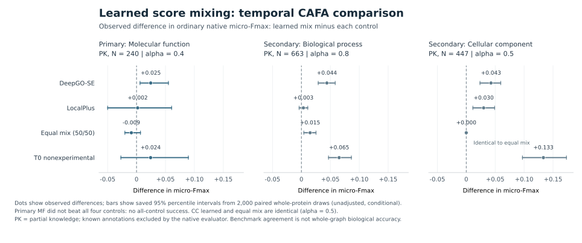

# Learned-combination results — November 15, 2026

**The fitted mixture failed its declared primary molecular-function gate.**
There is a useful secondary result: combining graph and sequence predictions
improves cellular-component prediction over both parents and the contemporary
annotation control. That aspect selected exactly 50/50, so this demonstrates a
bounded **mixing benefit**, not a benefit unique to learning weights.

The [frozen protocol](LEARNED_COMBINATION_PROTOCOL_20261115.md) and implementation
were locally committed as `0a572f6` before new reference terms were opened.
The [machine-readable summary](learned_combination_20261115_summary.json)
retains every declared stratum and all 24 paired contrasts. Previous failed
comparisons remain unchanged. No graph, model or app default was replaced.

## What was compared

Adapt [DeepGOPlus's published score-combination approach](https://doi.org/10.1093/bioinformatics/btz595):
`alpha × LocalPlus + (1−alpha) × DeepGO-SE`, with one weight per GO aspect.
Fit exactly eleven weights on previously consumed CAFA5 PK development
outcomes. Exclude all 7,401 later-reference accessions and identical full
sequences, leaving **4,948 development proteins** before native per-aspect
eligibility. Selected LocalPlus weights: **MF 0.4, BP 0.8, CC 0.5**.

Seal all five final forecast arms before opening new GO terms. Evaluate once
using the [LAFA September 2025–March 2026 author release](https://github.com/FriedbergLab/CAFA_forever/tree/c3fd5b9a5226348d88b9efadddb3214c803b80c4/data/releases/Sep_2025_Mar_2026).
The fixed intersection contains **1,163 human forecast targets**, all with
identical full sequences in the old forecast input and later T0 release.
The annotation comparator reproduces the author's nonexperimental baseline
on human GOA September 4, 2025, rather than using stale 2023 annotations.

Scores below are ordinary native micro-Fmax. Each column uses the same
reference, ontology, masks, propagation and threshold grid within its row.

| PK aspect | Eligible proteins | DeepGO-SE | LocalPlus | Equal mixture | Learned mixture | T0 annotations |
|---|---:|---:|---:|---:|---:|---:|
| MF — primary |240|0.170664|0.193277|0.204193|0.195205|0.170872|
| BP — secondary |663|0.117779|0.158381|0.146805|0.161829|0.096616|
| CC — secondary |447|0.291414|0.304108|0.334168|0.334168|0.200819|

PK means the native partial-knowledge task: assess accumulated functions while
excluding functions already known at T0. MF concerns molecular activity, BP
biological processes, and CC cellular location or structures. These are GO
function-prediction scores, not accuracy percentages for Pharos relationships.

## What the intervals support

All intervals below use 2,000 paired whole-protein resamples, seed 20261113.
They are conditional, unadjusted descriptive 95% intervals. Positive values
favor the learned mixture. All declared comparisons are retained in the JSON.

| Aspect | Compared with | Point difference | Paired 95% interval |
|---|---|---:|---:|
| MF — primary |DeepGO-SE|+0.024542|[+0.006045,+0.055102]|
| MF — primary |LocalPlus|+0.001928|[−0.049955,+0.060648]|
| MF — primary |Equal mixture|−0.008988|[−0.020152,+0.006827]|
| MF — primary |T0 annotations|+0.024333|[−0.027070,+0.089598]|
| BP — secondary |LocalPlus|+0.003448|[−0.003916,+0.011010]|
| BP — secondary |Equal mixture|+0.015024|[+0.004217,+0.025230]|
| CC — secondary |DeepGO-SE|+0.042754|[+0.023755,+0.059602]|
| CC — secondary |LocalPlus|+0.030061|[+0.011451,+0.048976]|
| CC — secondary |Equal mixture|0.000000|[0.000000,0.000000]|
| CC — secondary |T0 annotations|+0.133350|[+0.097159,+0.173174]|

Molecular-function fitting does not beat simple averaging or establish a gain
over LocalPlus. Biological-process fitting helps relative to averaging,
DeepGO-SE and annotations, but its advantage over LocalPlus remains uncertain.
Cellular-component mixing has the clearest bounded gain over both parents;
the fitted and fixed mixtures have identical curves and bootstrap draws.
This secondary finding does not replace the failed primary endpoint.

The three limited-knowledge (LK) groups are reported separately:

| LK aspect | Eligible proteins | DeepGO-SE | LocalPlus | Equal mixture | Learned mixture | T0 annotations |
|---|---:|---:|---:|---:|---:|---:|
| MF|9|0.309859|0.238806|0.307692|0.320988|0.220183|
| BP|19|0.448485|0.432602|0.480769|0.464849|0.528905|
| CC|16|0.600000|0.577259|0.620690|0.620690|0.466667|

These populations are too small for a broad transfer claim. The three
no-knowledge (NK) strata have **no released reference rows in this frozen
intersection**; they are unavailable, not scored zeros. All nine declared
strata therefore remain represented, with six actually evaluated.

## Verification and limits

- All 37 synthetic checks passed without skips on the pinned native runtime.
  Per-protein counts reproduce every ordinary native curve column; maximum
  absolute difference across 30 final curves was `7.77e-16`.
- A separate agent audited source pins, 33 development curves, 30 final curves,
  the fit→seal→reference-opening chain, and all 24 bootstrap contrasts. It
  independently reproduced the failed primary gate and equal/learned CC ties.
  Its aggregate-audit receipt has SHA256
  `a8a75b3bd859ecd395a1f7e846a0c63ba59e3654bfad2e867199e4bacb789160`.
- This is a retrospective external temporal measurement. Later GOA source
  material was previously processed for source QC, so it is not wholly
  developer-blind. Base-model training, homologues, identical truncated
  sequence inputs and independent studies are not established disjoint.
- Curator annotation growth is incomplete. Missing reference matches are not
  experimentally verified biological negatives. These results do not establish
  whole-graph biological accuracy, clinical accuracy or all-question transfer.
- The exact IA file was unavailable. No IA values were invented; this is an
  ordinary unweighted comparison, with a denser threshold grid than the
  published LAFA leaderboard.
- This LAFA frame is now consumed. Further changes must not be tuned against
  these outcomes and then described as independent confirmation.

The operational decision is to retain the mixture as a qualified experimental
comparison, report the CC mixing gain with its scope, and preserve the parent
and annotation controls. A learned global combiner is not adopted as the
general default. The comparison used existing forecasts and CPU compute;
neither a model server nor new GPU inference was required.
