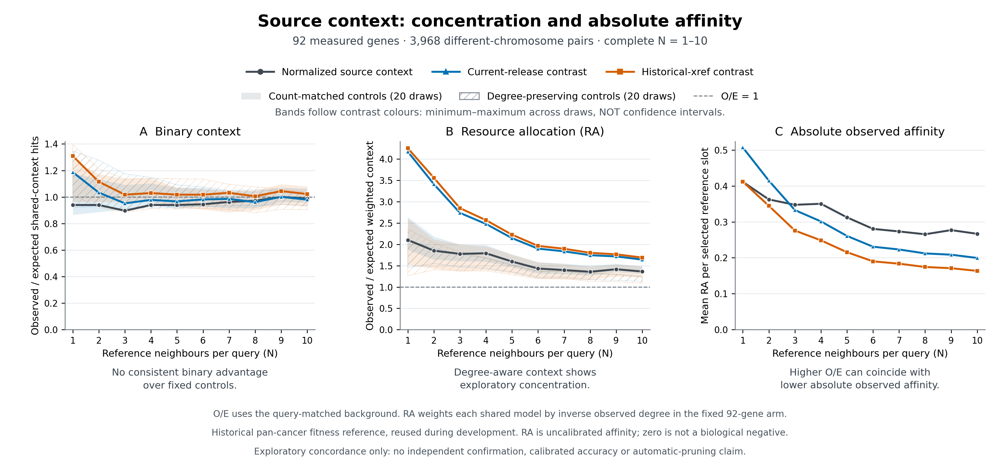

# Exploratory degree-aware functional concordance

The resource-allocation (RA) extension found a bounded positive contextual
signal: both fixed source-qualification contrasts exceed the normalized source
and all forty own-treatment matched control draws at every declared N=1…10.
This is **exploratory concordance with an already consumed experimental
reference**, not independent biological accuracy, physical-binding prediction
or evidence for automatic biological pruning. The production graph is unchanged.

The earlier binary-context comparison remains preserved and negative for
consistent control superiority. This RA extension was proposed after that
result, then frozen before any new RA weights or results were calculated.
No new data, learner, sign selection, threshold, source arm or reference rank
was introduced. Jaccard and other alternative scores were not tried.

## Known method and verified gap

The original indicator treats any shared source context equally, whether it
contains two measured genes or most of the cohort. The standard RA index sums
inverse degrees of shared neighbor nodes. We called the installed **NetworkX
3.7 `resource_allocation_index`** with its native CPU backend; we did not
implement a new graph-learning or correlation algorithm.

Sources: [NetworkX API and implementation](https://networkx.org/documentation/3.7/reference/algorithms/generated/networkx.algorithms.link_prediction.resource_allocation_index.html),
[Zhou, Lü and Zhang](https://doi.org/10.1140/epjb/e2009-00335-8),
[Wainberg experimental reference](https://doi.org/10.1038/s41588-021-00840-z).
The RA paper establishes a local-information network score, not biological
validity for Wiki memberships.

Each unchanged source arm becomes a simple undirected gene–model incidence
graph with distinct gene and exact-version model namespaces. All 92 measured
genes, including isolates, are present. Model degree is fixed in the full
92-gene arm; it is not recalculated per query or after chromosome filtering.
It is **observed cohort-local degree**, not the complete biological pathway
size. Different source revisions remain distinct, potentially correlated
contexts. Incorrect attribution and source reuse are not repaired by weighting.

The same 3,968 nonsyntenic gene pairs, original native two-sided GLS ranks,
fractional boundary ties and all ten N points are reused. At each reference
position, the readout measures RA affinity instead of a binary context hit.
Expected weighted score uses each query's eligible-partner background.
All 92 queries stay in the denominator, including zero-source-score queries.
RA can exceed one and is not an edge probability; zero is not a biological
negative. No native P value is converted into a false-edge label.

The original 87 arms include twenty measured-frame count subsets and twenty
degree-preserving draws per treatment. The descriptive full-curve claim rule
was fixed before weights: every N must exceed normalized and each of the forty
own-treatment matched draws by more than 1e-12. This is a project reporting
constraint, not a significance test, confidence interval or uniform-null claim.
All legacy controls remain visible as diagnostics.

## Complete primary curve

The complete N=1…10 curves show the distinction between binary context (A),
degree-aware concentration relative to background (B), and absolute observed
affinity (C). Control bands are the minimum–maximum of twenty draws per type
and contrast, **not confidence intervals**. The same 92 measured genes and
3,968 nonsyntenic pairs remain in every primary point. This is a presentation
of the consumed-reference exploratory results, not a new accuracy or pruning
claim. [Editable vector figure](../images/functional_concordance_20261113.svg)
and [aggregate source/runtime pins](functional_concordance_20261113_sources.json)
are provided; no raw matrix, pair or per-gene outcomes are included.

Observed/expected weighted-context enrichment:

| N | Normalized | Current-release contrast | Historical-xref contrast |
| ---: | ---: | ---: | ---: |
| 1 | 2.101492 | 4.169709 | 4.250473 |
| 2 | 1.851530 | 3.410066 | 3.557785 |
| 3 | 1.775842 | 2.736676 | 2.847508 |
| 4 | 1.790135 | 2.477554 | 2.566210 |
| 5 | 1.596897 | 2.145370 | 2.225518 |
| 6 | 1.433460 | 1.898952 | 1.963171 |
| 7 | 1.396696 | 1.835583 | 1.895972 |
| 8 | 1.356657 | 1.745348 | 1.801116 |
| 9 | 1.415905 | 1.716115 | 1.766063 |
| 10 | 1.363106 | 1.641709 | 1.689495 |

Both treatment curves meet the fixed descriptive rule against their matched
controls at all ten N points. The full twenty-draw minimum/median/maximum
envelopes and all 87 curves are retained in the readable report and machine
outputs. No best N or winning treatment was selected.

## The denominator tradeoff matters

This is concentration relative to each arm's background, not improved recall
or a calibrated precision estimate. Qualification often lowers absolute
observed affinity while lowering expected background more. Mean observed RA
per selected query-partner slot is:

| N | Normalized | Current-release contrast | Historical-xref contrast |
| ---: | ---: | ---: | ---: |
| 1 | 0.411183 | 0.506890 | 0.411650 |
| 2 | 0.362275 | 0.414544 | 0.344565 |
| 3 | 0.347466 | 0.332683 | 0.275776 |
| 4 | 0.350263 | 0.301183 | 0.248532 |
| 5 | 0.312453 | 0.260801 | 0.215537 |
| 6 | 0.280474 | 0.230846 | 0.190129 |
| 7 | 0.273281 | 0.223142 | 0.183621 |
| 8 | 0.265447 | 0.212173 | 0.174435 |
| 9 | 0.277040 | 0.208619 | 0.171040 |
| 10 | 0.266709 | 0.199574 | 0.163624 |

Expected mean RA per slot is constant over N: 0.195663 normalized, 0.121565
current and 0.096848 historical. Absolute sums, expected scores, per-query
records and every control draw are saved. Opposite query directions are slots,
not independent experiments.

## What can be retained

The result supports further evaluation of a known degree-aware **contextual
ranking or source-inspection feature**. It does not justify deleting assertions
whose context score is low, classifying unobserved pairs as false, claiming
whole-graph scientific accuracy, or changing the default graph policy.
The current-release contrast retains its known source-vintage limitations;
its favorable RA result does not erase historically supported exclusions.

Stronger biological-improvement claims require fresh task-matched evaluation.
This reference is historical pan-cancer perturbation fitness, not CRC-specific
causality or physical binding; GO-assisted preprocessing and indirect evidence
reuse remain disclosed. Unassessed claim families and the old audit's scientific
truth axis remain unchanged.

## Artifacts and validation

Under `runs/coessentiality_resource_allocation_20261113/`:

- `frozen_v1/`: RA contract, native NetworkX source/version/license pins and
  exact consumed reference/source inventories; seal `20323d2b…`.
- `scored_v1/`: all 87×10 curve points, native RA scores, full-arm model degrees,
  absolute weighted sums and compressed per-query scores; seal `795f60cf…`.
- `readable_v1/report.html`: all curves, control envelopes and both absolute
  score tables; rendering seal `379033e3…`.
- `independent_review_v1/`: a separate implementation reconstructs inverse-model
  degree sums and fractional native-reference selections without NetworkX or
  the producer scorer; seal `7439925d…`. All 345,216 RA pair scores match, and
  all 870 RA plus 870 original binary curve points agree within floating-point
  tolerance (maximum RA curve discrepancy 8.53×10⁻¹⁴).

The original raw-column reference and every native GLS selection were replayed
exactly before weights. `PYTHONHASHSEED=2026111301` fixes the native unordered
common-neighbor summation order. Seven focused controls pass in the reviewed
runtime, including full-frame degree specificity, inverse-degree native parity,
isolate retention, exact-version identity, scores above one, fractional ties
and zero-expected/UNKNOWN handling. Optional native tests skip when NetworkX3.7
is absent. No learner, GPU, Brev instance or additional source retrieval was used.

Code: `tools/coessentiality_feasibility/resource_allocation.py`; method contract:
`tools/coessentiality_feasibility/ra_contract.md`. Independent arithmetic review
validates implementation and reporting; it does not turn this consumed-reference
result into independent biological truth or justify promoting it to the app's
automatic biological decisions.
