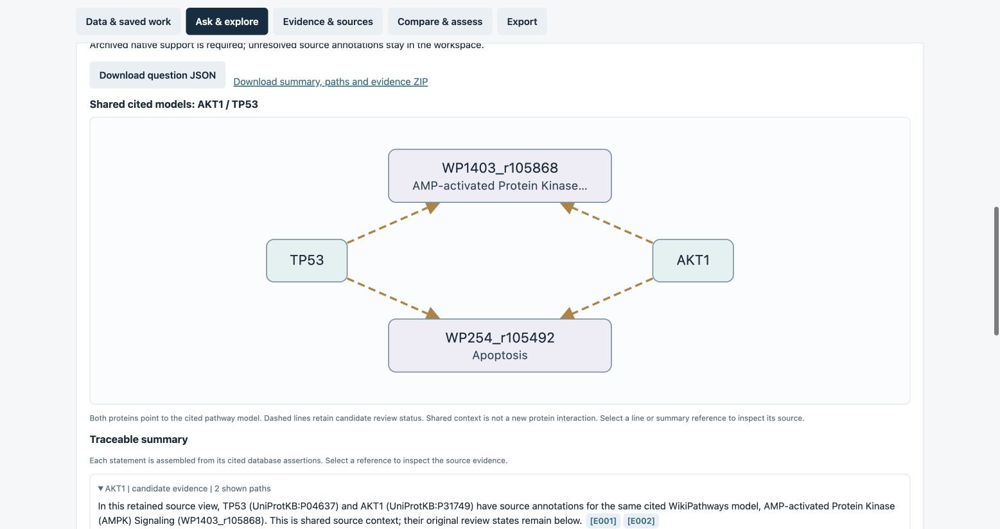
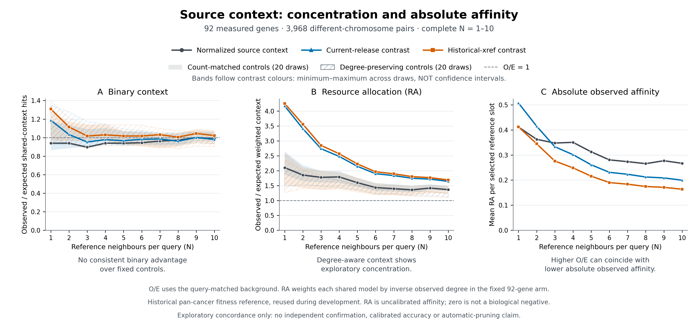

# Biological assessment and delivery — 13 November 2026

The corrected source graph is now in use in the private AWS workbench and
Neptune. Its strongest demonstrated improvement is more faithful, inspectable
use of source evidence. The completed biological comparisons do **not** yet
show a transferable predictive gain or independent whole-graph accuracy.

## Delivered

- **16,687 retained evidence records across 99 protein targets.** The original
  16,985 records, reviews and complete keep/prune/abstain ledger remain available.
  The 298 exclusions concern obsolete GO identifiers in the pinned July 2026
  ontology; they are not 298 experimentally disproved relationships.
- **Exact historical pathway inspection.** Publisher archives verified 253/308
  cited WikiPathways versions, including 15/20 versions most frequent in source
  records. Five connections rejected by the newer flat-file contrast are
  explicitly gene-encoded in their historical models. Unknown memberships are
  retained; gene compatibility never establishes an exact historical isoform.
- **A working question → graph → source explanation.** The qualified pathway
  question joins both proteins through the same cited model. It includes native
  GPML downloads, separately scoped references and source status. Shared model
  context is not displayed as a newly established physical interaction.
- **Direct inspection of curator and mechanistic context.** The existing source
  guide now opens exact complete CIViC profiles for their Assertions and exact
  Reactome records for event/complex details. Current lookup context remains
  separate from historical references and independent evidence counts; clinical
  status, whole-regimen exceptions and species inference stay explicit.
- **Private production use.** A complete reconstruction of the corrected Neptune
  dataset matches the retained graph. The app's native-supported TP53 answer,
  downloads, current-GO lookup and real database inspection passed across an
  actual service restart. The previous cloud dataset and app image remain
  preserved. Normal read-only database permissions were restored; no public
  access was added.

The input remains its explicitly dated Pharos319 snapshot. Historical source
proof and current curator lookups have separate versions; this is not a claim
that Pharos319 is the latest available Pharos release.

The actual hosted walkthrough also checked the
[native source passport](../images/hosted_source_passport_20261113.png),
[assessment denominators](../images/hosted_scientific_assessment_20261113.png),
[clinical context guide](../images/hosted_clinical_source_guide_20261113.png) and
[Reactome context guide](../images/hosted_reactome_source_guide_20261113.png).
The [sanitized deployment receipt](aws_source_faithful_release_20261113_summary.json)
binds the deployed runtime, graph, saved answer and actual restart/database checks.

## What credible public labels establish

| Axis | Bounded finding | What it cannot establish |
|---|---|---|
| Native experimental GO curations | 373/4,078 original GO assertions have qualified compatible records; all 373 survive | Independent precision; GO/Pharos source lineage can overlap |
| Published CRC genomic cohort | 32/100 disease assertions have eligible coding-driver cohort support; all 32 survive | Clinical causality, exact rectal-context support, or correctness of unmatched claims |
| Expert CIViC assertions | Two accepted expert claims were recovered, but 0/41 original response contexts match exactly | Validation of different therapy, variant or disease contexts |

These are **support-coverage and preservation measurements**. Missing matches
stay unknown. A probability sample cannot turn positive-only or mismatched
labels into a calibrated accuracy estimate. Independent whole-graph scientific
precision remains **not estimable from the admitted labels**; no substitute
percentage or LLM-consensus truth label is reported.

A concrete clinical-scope example explains the strict matching rule:
[CIViC Evidence Item 12264](https://civicdb.org/evidence/12264) reports a complete
sotorasib–panitumumab regimen, while
[Assertion 295](https://civicdb.org/assertions/295) explicitly excludes
panitumumab given with a KRAS G12C inhibitor from its scope. These records
cannot be turned into contradictory correctness labels by matching only a gene
and one drug. The new current-profile lookup exposes the curator context while
preserving that distinction. See the
[source and reference assessment](SOURCE_FAITHFUL_WORKSPACE_20261113.md).

## Controlled biological comparisons

| Comparison | Result and decision |
|---|---|
| Matched R-GCN physical-assay comparison, 1,751 eligible measured pairs | Historical context AP 0.71027 versus normalized 0.70978, below its count control 0.72097 and degree control 0.71133. No robust predictive gain. |
| Published coessentiality, original 92-gene development scope | Binary shared-context qualification failed its fixed control comparison. An explicitly exploratory native resource-allocation (RA) extension showed greater relative concentration, with usually lower absolute affinity. |
| Frozen transfer to 128 new sampled genes, 7,648 nonsyntenic pairs | Neither RA nor the binary diagnostic beat baseline and all 40 fixed controls at any N=1–10. Historical context reached only 26 queries; all 102 zero-context queries remained. The development advantage did not transfer. |

Independent software review replayed the preserved native column bytes,
321,216 RA weights and all 840 curve points exactly. This verifies arithmetic, not independent
experimental replication: both functional cohorts use the same published
study. No favorable N, replacement sample or new method was selected after the
transfer result. RA weighting and automatic biological pruning were **not**
promoted to the default graph.

Full curves, controls, exposure boundaries and source receipts are in the
[prospective assessment](PROSPECTIVE_GENE_TRANSFER_20261113.md). The control
bands are ranges across fixed draws, not confidence intervals. Pooled O/E is
not coverage-adjusted: zero-context queries add zero to both sums. Absolute
means and effective coverage therefore remain beside each enrichment ratio.

### Separate local-cohort demonstration

The [saved 128-gene pathway workspace](http://127.0.0.1:8794/?run=transfer_pathway_workspace_20261113&question=question_transfer_pathways_20261113)
demonstrates the same workflow on different genes using the existing publishers.
It retains all **1,470 pathway records with zero prunes**, including unresolved
Wiki annotations; no assertions were accepted. Other annotation families were
not retrieved. The alphabetically selected ABCC3 question returns three proteins
with exact native source context. This link requires the complete private saved
packet and the local server on port 8794; it is not a fresh-checkout example.
Actual [graph](../images/transfer_source_graph_20261113.png) and
[source-passport](../images/transfer_source_passport_20261113.png) captures show
the second cohort using the same interface.

Workflow reuse does not reverse the negative comparison above: the new genes
were evaluated within the **same published study**, not an independent study.
The existing answer format repeats native proof, producing a roughly **64 MB
saved question JSON**; this remains an engineering limit. No new scoring,
retrieval, AWS deployment or Neptune load was needed for this local example.

## Literature-guided decisions

Published pathway-coverage and multifunctionality studies support the use of
coverage diagnostics and matched controls; they do not prove a single cause
of this negative result. RA uses degrees in the supplied cohort, which are
not full biological pathway sizes. The
[focused methods review](PATHWAY_TRANSFER_LIMITS_20261113.md) distinguishes these
verified properties from causal hypotheses.

The other proposed routes were screened before execution. PROGENy requires
appropriate expression/footprint measurements; total proteomics and this sparse
scope do not supply them. The inspected Sanger preprocessing lacks required
olfactory-control genes; the Horlbeck genetic-interaction panel has inadequate
compatible coverage. No unsupported assay conversion or benchmark substitution
was made simply to obtain a positive result.

The existing source guide now supplies a bounded route to **native
reaction/complex roles and context from already represented Reactome records**. Existing Content Service
and BioPAX tooling can support this without treating the same source as new
independent evidence. Any later automatic extraction still requires a bounded source question and
explicit release lineage; the lookup is not a new pruning rule or a demonstrated
prediction gain.

## Practical limits

Five of the twenty most frequent historical versions remain unresolved after
additional official archive/repository checks. No nearby or current model was
substituted. Their 365 source rows / 119 protein-version connections remain
UNKNOWN. Full historical archive/registry replay requires the complete workspace
package; compact answer ZIPs contain their cited native models and provenance.

The hosted cold source replay took about 90 seconds, and the complete first
Neptune parity check about four minutes; warm saved-data questions were about
20 seconds on this existing host. These are observed production timings, not
latency guarantees. HTTP gzip and bounded database projection reduce transfer
and materialization work while preserving byte/row equality. Normal questions
use the verified file-backed workspace; the Neptune inspector performs actual
read-only database queries.

The complete data remain in private storage under their source terms. MIT
software licensing does not clear redistribution of every integrated source.
No Brev/GPU/model inference was needed for this round's CPU evaluation and
production deployment.

## Preservation and operational handoff

The corrected hosted workspace has a completed private S3 backup. A first
isolated recovery attempt stopped safely because the older full backup also
contains runtime symlinks. The revised three-root recovery checker preserves
strict ordinary-file checks on the selected graph, publication and question;
eleven offline safety controls pass. Its remote execution remains **pending**:
automatic approval review requires explicit approval to transfer that script
and the private backup receipt. No recovery validation or full VM restoration
is claimed, and no active files or service were changed by the blocked action.

The complete new scientific artifact archive is retained locally at
`runs/scientific_retention_20261113/scientific_artifacts_20261113.tar.gz`
(488,560,385 bytes; SHA256
`227aa64bc35a8d67ff831af6107ba6394ed4ad167db0f8af2b17aef0ec16b438`).
It preserves 2,982 files across ten source/experiment/delivery roots, with a
per-file manifest. Automatic approval review separately blocked its proposed
private S3 copy until the exact payload and destination are approved. No
alternate upload was attempted. Local retention is complete; a second remote
research copy is not claimed. Underlying source terms still apply.
