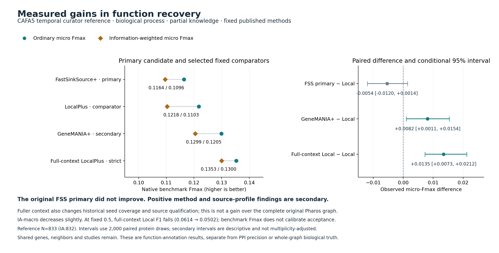
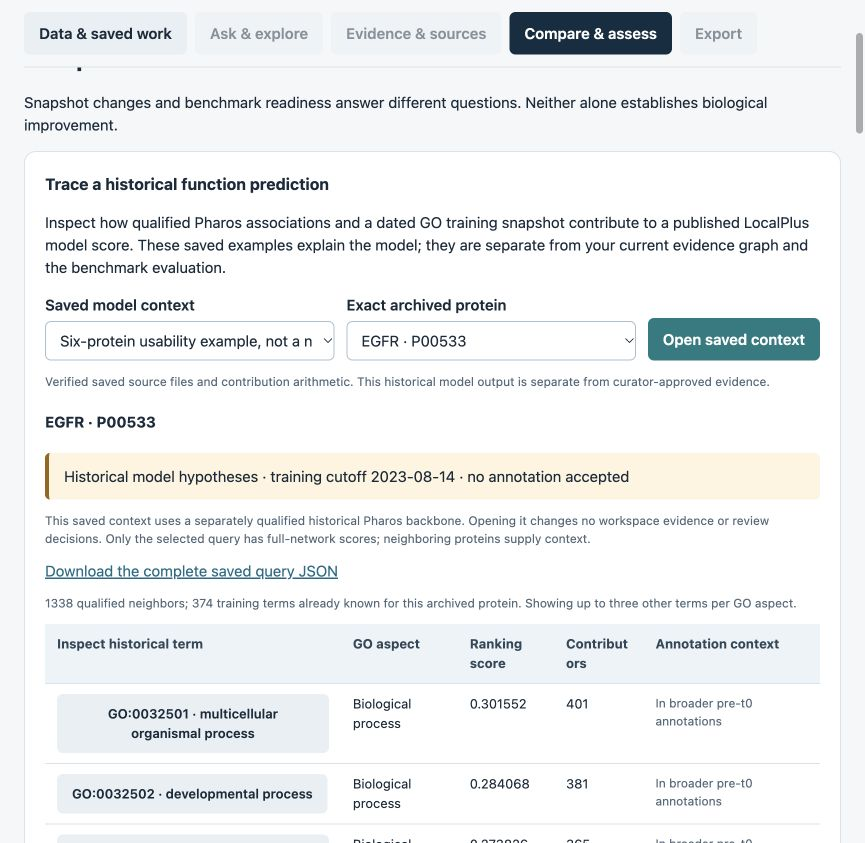
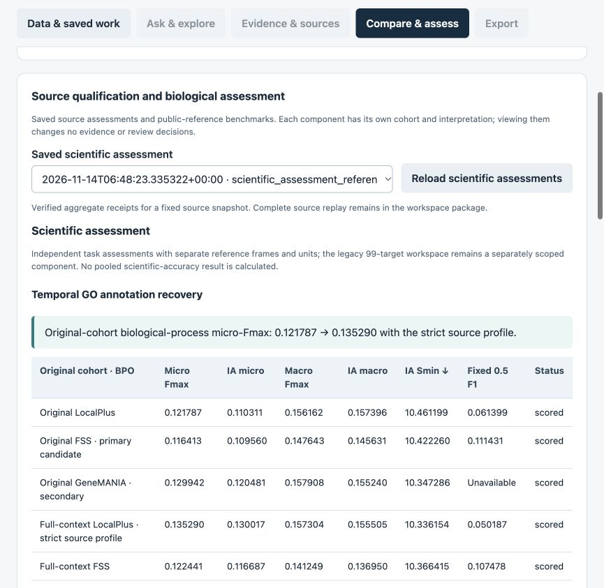

# Measured function recovery and evidence verification

November 14, 2026. Completed scientific reference assessments and product update.

BioGraph Steward now has measured improvements on a public, time-separated
protein-function reference. They concern recovery of later curator annotations,
with the original unsuccessful candidate and unfavorable readouts preserved.
The useful full-context model is also inspectable in the app, rather than
existing only as an evaluation spreadsheet.

## Controlled comparison

The reference is the official [CAFA5 v2 release](https://zenodo.org/records/22381862),
scored by its unchanged [published evaluator](https://doi.org/10.1093/bioadv/vbae043).
All predictions and comparison rules were sealed before their future GO term
labels were decoded. Inputs use historical STRING weights represented in the
Pharos archive, historical identity support and the benchmark's known-at-t0 GO
annotations. The reference contains subsequently admitted curator annotations;
the [CAFA5 paper](https://doi.org/10.64898/2026.04.27.716980) includes experimental
evidence codes as well as TAS and IC. It is not exclusively direct-assay evidence.

On the original protein cohort, 833 proteins have eligible biological-process
reference annotations; 832 qualify for the information-weighted readout.

| Historical model/source profile | Micro Fmax | IA micro Fmax | Macro Fmax | IA macro Fmax |
| --- | ---: | ---: | ---: | ---: |
| Original scoped LocalPlus | 0.121787 | 0.110311 | 0.156162 | 0.157396 |
| Original FastSinkSource+ — primary candidate | 0.116413 | 0.109560 | 0.147643 | 0.145631 |
| Original GeneMANIA+ — secondary method | 0.129942 | 0.120481 | 0.157908 | 0.155240 |
| Full historical LocalPlus, strict source profile | 0.135290 | 0.130017 | 0.157304 | 0.155505 |

Two useful findings are supported:

- **Same-graph method comparison:** the unchanged published GeneMANIA+
  implementation improves micro-Fmax over LocalPlus by 0.008156. The paired
  protein-bootstrap 95% interval for the difference is [0.001058, 0.015402].
- **Source-context comparison:** full historical LocalPlus with strict alias
  qualification improves micro-Fmax by 0.013503, about 11.1% relative to the
  earlier scoped model. Its paired interval is [0.007272, 0.021208].

The original primary FastSinkSource+ candidate did not beat LocalPlus. Both
positive contrasts are secondary findings, with descriptive intervals rather
than multiplicity-adjusted confirmatory tests. All use the fixed published
methods/defaults from the [author implementation](https://github.com/Murali-group/multi-species-GOA-prediction)
and its [method paper](https://doi.org/10.1093/bioinformatics/btaa885).

The full-context comparison changes source coverage, available historical
training seeds and source qualification. It restores useful existing context
lost by our earlier scoped retrieval; it does not establish superiority over
the complete original Pharos network. The clean method-only contrast is
GeneMANIA+ versus LocalPlus on the same original graph.

The subsequent [fixed combination assessment](COMBINED_CONTEXT_AND_SKILLS_20261114.md#completed-biological-comparison)
did not establish that the two gains stack into a better product default.
Full-context GeneMANIA+ scores 0.134997 on original-cohort BPO, versus
0.135290 for full strict LocalPlus. Its additional-cohort ordinary gain is
positive, while its IA gain remains uncertain. The predeclared retention gate
fails; the deployed LocalPlus inspector and the original results stay intact.

Fmax is the best F1 across the official benchmark threshold grid. It is not an
accuracy percentage or a calibrated probability. Improvements are metric
specific: IA-macro Fmax decreases slightly with the fuller LocalPlus profile.
At the unchanged 0.5 cutoff, precision increases from 0.171722 to 0.300319,
while recall decreases from 0.037382 to 0.027381 and F1 from 0.061399 to
0.050187. No automatic acceptance threshold is inferred from these results.

## Transfer and pruning

The separately frozen additional protein cohort has 2,826 eligible BPO targets
outside the original scoped graph. Full-context LocalPlus reaches micro-Fmax
0.139968, compared with 0.131961 for full-context FSS, 0.066423 for the official
ProtT5 neighbor baseline and 0.091528 for pre-deadline non-experimental
annotations. Its paired difference intervals are respectively
[0.004778, 0.011823], [0.064964, 0.081994] and [0.039611, 0.057441].
The strict source profile scores 0.139966; its difference from the nominal full
profile is compatible with zero. These are same-study, transductive protein
transfers, rather than an independent study or an unseen-gene experiment.

The three fixed pruning views each retain 71,404 of 87,688 original weighted
pairs. None has a paired ordinary or IA-weighted BPO recovery interval excluding
zero versus the unpruned comparator. They remain optional sparsification
views. A separate 53-protein later-publication subset also has a context-gain
interval spanning zero. Those results are retained alongside the positive
findings.

We also froze and executed the native no-knowledge (NK) and limited-knowledge
(LK) tasks after the PK results. NK has no admitted experimental annotation in
any GO aspect at t0; LK is assessed only in an aspect lacking such annotation.
LK can overlap a PK protein in another aspect. All five original transport
arms and the separately frozen GeneMANIA+ supplement were sealed before these
new reference term columns were decoded.

| Native task | Eligible N | Strict Local+ | GeneMANIA+ | Strongest fixed native control | Control Fmax |
| --- | ---: | ---: | ---: | --- | ---: |
| NK biological process | 44 | 0.320179 | 0.312722 | Non-experimental annotations | 0.359951 |
| NK molecular function | 39 | 0.400000 | 0.403670 | Non-experimental annotations | 0.521600 |
| NK cellular component | 118 | 0.613718 | 0.625611 | Frequency baseline | 0.715778 |
| LK biological process | 227 | 0.329733 | 0.343803 | Non-experimental annotations | 0.329572 |
| LK molecular function | 60 | 0.422316 | 0.459175 | Non-experimental annotations | 0.597970 |
| LK cellular component | 197 | 0.602243 | 0.625532 | Frequency baseline | 0.666876 |

This table uses ordinary micro-Fmax; all 36 method/task slots and their ordinary/IA/macro/Smin/fixed-cutoff
readouts remain in the separate transfer artifact. LocalPlus improves over
several simple/sequence controls in BPO, but neither graph method establishes
a BPO advantage over the non-experimental annotation control in these NK/LK
frames. The narrow unadjusted LK GeneMANIA-versus-Local interval is exploratory
and does not change that conclusion. The
[CAFA5 primary paper](https://doi.org/10.64898/2026.04.27.716980) also reports
strong non-experimental baselines and substantially different task difficulty
by prior knowledge. These results support a task-specific role for graph
context, rather than one universally superior predictor.

## What is retained in the product

**Compare & assess** now includes a historical function-context inspector.
Its saved queries use the strict 20,412-protein source profile with 985,863
qualified native weighted pairs. Each hypothesis exposes the original
neighbor contributions, raw STRING weights, source pair IDs and historical
training terms; the score reproduces the saved full-graph LocalPlus result.
Ambiguous product identities can abstain instead of inheriting another
product's neighbors.

The display also identifies broader pre-t0 annotation reuse, exact versus
ancestor-only current curation, and terms deprecated in the newer ontology.
For the six saved demonstration queries, 12 of 36 displayed concepts already
occur literally in the broader pre-t0 annotation baseline, and four displayed
historical terms are now deprecated. Those warnings prevent treating a later
curation match or an old model term as a newly discovered function. Missing
current matches remain unresolved. A [versioned term-content audit](GO_TERM_CONTENT_CURRENCY_20261114.md)
also checks labels, definitions and explicit ontology parents: an unchanged GO ID
alone does not establish unchanged meaning. All 32 active displayed rows retain
identical labels and definition text, while four active terms have changed parent
records; historical and current closures therefore remain separate.

The model context is a separate historical view. It does not overwrite the
99-target source workspace, infer direct protein binding, or promote
hypotheses into accepted GO annotations. The app requires no scientific
Python packages, model server or GPU to inspect its saved results.

The native GO construction increment preserves complete source annotations,
including relations, qualifiers, references, forms and extensions. Its
standards projection now carries 16 of 24 new native rows through the strict
KGX profile, with all 24 source bodies and every withheld reason preserved.
See [standard export](../STANDARD_EXPORT.md) for the known source-registry and
Biolink model/API compatibility limits; this is not full standard conformance.

## Interpretation and reproducibility

The changes address reusable failure mechanisms, not just these examples:

| Observed problem | Retained response | Practical limit |
| --- | --- | --- |
| Scoped retrieval discarded useful neighbors and training context | Full qualified historical backbone and an exact one-hop explanation | The positive result is recovery of lost context, not a win over complete Pharos |
| Distinct archived protein products shared a STRING representative | Keep exact accession identities and abstain for unresolved projections | A locus cross-reference is not proof of isoform or construct equivalence |
| A concept looked new only because it was absent from one training subset | Show broader pre-t0 annotation reuse separately | The display checks the saved context; missing matches remain unresolved |
| An active GO ID changed meaning or ontology parents | Keep versioned ontologies and audit literal content against official curator records | The completed content audit covers the displayed and worked-example terms, not every GO term |
| The LLM overcalled source relations | Compare with curator labels and a published specialist; reject failed automatic adoption | Gold entities and released-checkpoint training uncertainty constrain this component |

The official evaluator, prediction implementations and scientific dependencies
remain optional, separately pinned research tools. Native point estimates,
complete declared outcome slots, exact denominators, negative controls and
paired intervals are carried in a task-specific aggregate publication. The
older 99-target source-coverage assessments retain their own graph hash and
denominators and are not pooled into a global accuracy number.

These are public retrospective reference assessments. The project had already
inspected newer GOA sources; historical features were enforced, but the work
is not claimed to be completely developer-blind. Proteins share neighbors,
genes and studies, so protein-resampling intervals are conditional, not
independent-study replication. Curator coverage is incomplete: an unmatched
predicted function is not established to be biologically false.

The historical Pharos baseline is deliberate for temporal evaluation. Newer
source content is inspected separately, so later reference information cannot
silently enter the predictor. This does not make Pharos319 the preferred
current source for every future user question.

Research reproduction and exposure boundaries:

- [Complete sanitized PK outcome capsule](cafa_function_recovery_20261114_summary.json).
- [Complete NK/LK aggregate readouts](cafa_nonpk_transport_20261114_summary.json).
- [Sanitized BioRED assessment capsule](biored_source_relations_20261114_summary.json).
- [Two-page scientific update](../../output/pdf/BioGraph_Steward_Scientific_Update_20261114.pdf).

- [Official reference/evaluator adapter](../../tools/cafa_reference/README.md).
- [Published prediction methods and exact context inspection](../../tools/cafa_prediction/README.md).
- [Earlier experiment and hold-out ledger](../EXPERIMENT_HISTORY.md).
- [Source-faithful workbench delivery](SCIENTIFIC_DELIVERY_20261113.md).

The complete reference-transfer and agent executions are finished. Their failed
transport attempts, unsuccessful primary candidate and negative controls remain
in the experiment ledger; no comparison was retuned to obtain a positive result.

## Curator-reference relations and the NVIDIA agent

A separate source-relative assessment uses 128 fixed publications/pairs from
the [BioCreative VIII curator reference](https://doi.org/10.1093/database/baae069).
All six arms and their predictions were sealed before the selected relation
labels were opened. Gold entity spans/IDs are inputs; a `None` label means no
qualifying relation in that abstract, not a biological negative everywhere.

| Fixed arm | Exactly correct / 128 | Exact accuracy | Exact positive F1 | Unresolved |
| --- | ---: | ---: | ---: | ---: |
| Always no reported relation | 84 | 0.656250 | 0.000000 | 0 |
| Typed co-mention control | 35 | 0.273438 | 0.406977 | 0 |
| Published BioREDirect specialist | **100** | **0.781250** | **0.588235** | 0 |
| Specialist with type guard | 100 | 0.781250 | 0.588235 | 0 |
| NVIDIA model, flat context | 72 | 0.562500 | 0.470588 | 4 |
| NVIDIA model, bounded tool agent | 74 | 0.578125 | 0.486957 | 5 |

Unresolved outputs remain in the denominators. The agent overcalled source
relations: 34 false supports on 84 curator-`None` cases, versus nine for the
specialist. Its paired exact-F1 difference from the specialist has a 95% interval
of [−0.182857, −0.022845]; its difference from flat context spans zero. The
frozen agent-adoption criterion is **false**. Reading all three tools in the
same order on every case also demonstrates no adaptive retrieval benefit;
the agent used 512 model calls versus the flat control's 128.

On all **16,489 gene-involving pairs from 374 publications**, the specialist
achieves 14,176 exactly correct relations (accuracy 0.859725), positive F1
0.599788 (publication-cluster 95% interval [0.570150, 0.628134]) and pair F1
0.787983. The type guard changes zero predictions and is not an improvement.
Two native chemical–gene cotreatments also demonstrate why entity category
alone cannot impose a universal experimental-role restriction.

The primary 128 cases contain **no gold `Bind` relation**. In the complete gene
slice, native `Bind` recall is only 38/124 (30.6%); that category does not itself
guarantee direct physical binding. No PPI-curation accuracy claim follows.
The complete 28,734-row author-metric diagnostic gives relation F1 0.568428,
close to the paper's 0.5606 mean, supporting correct artifact integration.
Released-checkpoint training membership remains independently unaudited, so
these are curator-reference agreement results rather than fully audited
model-unseen accuracy. The co-mention control is not the original Pharos graph,
and this component performs no automatic graph acceptance or pruning.

See the [complete fixed comparison and limits](BIORED_SOURCE_RELATIONS_20261113.md),
[reusable implementation](../../tools/biored_agent/README.md),
[BioREDirect paper](https://doi.org/10.1093/bioinformatics/btaf226) and
[official code/artifacts](https://github.com/ncbi-nlp/BioREDirect).

## Hosted delivery

The private AWS workbench runs the accepted `a6a05ff` runtime. The named
`scientific_assessment_reference_20261114` publication passed its actual-reader,
authenticated API, catalogue, source-download and report checks. All prior graph,
question, review and assessment bytes remain unchanged. A Chrome sign-in and
visible EGFR context, identity-qualified CUX1 abstention and full result tables
were verified through the HTTPS reviewer gateway.

Saved inspection needs no Brev instance, model server or scientific Python
installation. The original 99-target graph/answer can take one to two minutes
on a cold load; saved function queries were subsecond on the tested host.
These are different operations, not a measured speedup. Keep AWS available
for team review.

A fresh native backup and [isolated checkpoint replay](scientific_hosted_delivery_20261114_summary.json)
verified all 454 selected files, the original eight-answer/export result, final
assessment, six function queries/36 notes and native GO packet round-trip. The
live container, configuration and source bytes remained unchanged. This is
selected data recovery, not full VM, credential or Neptune restoration.
