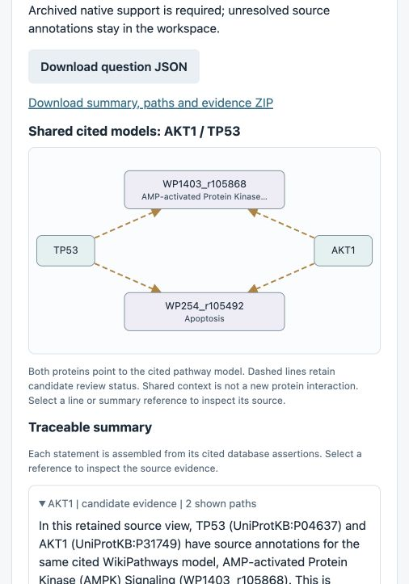
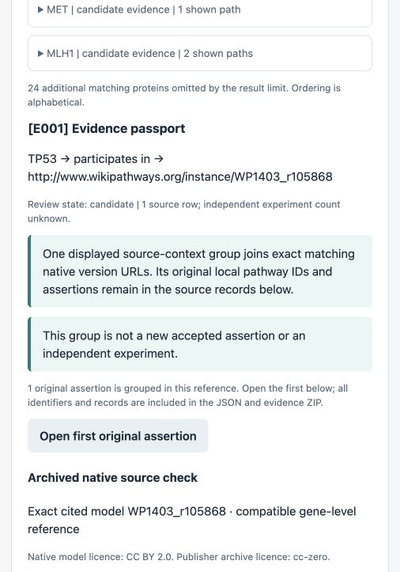

# Source-faithful pathway answers and bounded biological assessment

The app now queries a retained graph and joins WikiPathways annotations by
their exact cited model, with archived native evidence in each source passport.
Unknown source claims remain available. This applies to the frozen **99-target
colorectal workspace**, not the complete human Pharos database.

Both proteins point to a cited model. This is co-annotation context, not a new
protein interaction. The source diagram and its references preserve candidate
review status and distinguish literal protein references from gene-level
compatibility through a pinned registry.

## What changed in the working graph

The production candidate combines the existing GO identifier policy with
source-faithful historical WikiPathways qualification through the existing
Gold decision contract. Conflicting policies fail rather than overwrite one
another. Source snapshots, original assertions and review history remain in the
downloaded workspace.

| Evidence records | Count |
| --- | ---: |
| Original workspace | 16,985 |
| Explicit keep | 5,051 |
| Abstain, retained | 11,636 |
| Prune, obsolete GO identifiers in the pinned ontology | 298 |
| Current retained graph | 16,687 |
| WikiPathways claims pruned for missing native support | **0** |

The GO policy uses the pinned **2026-07-26** ontology; it is not certified as the
latest November release. An obsolete identifier is not a biologically false
association. Replacements remain unapplied unless separately qualified.

The prior current-GMT filter remains a recorded ablation. Five connections it
excluded are explicitly gene-encoded in their historical models. Newer parent
models sometimes use complexes or linked modules instead of those direct
references. Neither a current flat-file omission nor an unresolved historical
match establishes biological absence. The source-faithful default therefore
retains Wiki uncertainty; the answer can require native-supported context or
explicitly inspect all retained source annotations.

## Historical source verification

Publisher archives supplied **253 of 308 exact cited revisions**, covering
2,764 of 3,492 original Wiki evidence rows. Among 2,004 unique protein/model
connections, 59 have literal protein references, 996 have qualified gene-level
references and 949 remain unresolved. These are source-content findings, not
independent experimental labels or proof of exact historical protein forms.

The official legacy exporter identifies the Wiki revision in the archive
member filename. The optional GPML `Version` attribute is author/export
metadata and cannot generally serve as that revision. Actual publisher XSD
validation ran during preparation; the dependency-free app replays native XML,
archive membership and identifier matching against that byte-bound receipt.

Of the 20 versions most frequent in the original **source rows**, 15 were
recovered exactly. This is not a ranking of literature citation counts.
Focused official lookups did not recover the remaining five. Current pages
and nearby revisions were not substituted. The
[2024 WikiPathways paper](https://pmc.ncbi.nlm.nih.gov/articles/PMC10767877/)
documents the migration away from direct historical revision links and the
use of DOI-pinned archives for reproducible versions.

Native model/reference citations and exact element-attached links remain
separate. A paper listed by the model is not assumed to support every member.
Archive terms and each native model's license literal are preserved separately.
The compact answer ZIP includes cited GPML and provenance; complete offline
archive/registry replay requires the full workspace ZIP. No raw source package
is included in this repository's aggregate summary.

## What the biological checks establish

| Reference axis | Identified support | Interpretation |
| --- | ---: | --- |
| Native experimental GO curations | 373 / 4,078 GO assertions | Compatible curator records; shared source lineage remains explicit |
| Published CRC cohort genomic context | 32 / 100 disease assertions | Coding putative-driver support in the exact eligible disease scope; statistical prior assistance preserved |
| CIViC expert clinical assertions | 0 / 41 exact original contexts | Two expert claims were recovered separately; their clinical conditions do not match the original observations |

The default retained graph preserves all 373 GO-compatible and all 32
cohort-supported assertions. This is a bounded preservation result. It does
not certify the other assertions or measure false-removal rates. Positive-only
reference availability cannot establish whole-graph precision; an apparently
perfect percentage among selected positive matches would be misleading.

The CRC cohort reference preserves the authors' unit of 2,023 specimens from
2,017 participants, exact coding-gene scope, native Q/Q_CGC cells and prior
assistance. Source context excludes a coarse NRAS match because its original
record describes rectum adenocarcinoma, while the reference result covers the
broader colorectal cohort. It remains a diagnostic, not a forced positive.

## Controlled prediction comparisons

The existing native R-GCN workflow used the same supervision, union vocabulary,
masks, initialization seeds, optimizer updates and measured-assay adapter.
Input-adjacency and message-visibility checks proved that the source changes
reached the learner. Count-matched and degree-preserving controls were retained.

| Wiki context view | Mean average precision | Count control | Degree control |
| --- | ---: | ---: | ---: |
| Normalized source baseline | 0.70978 | — | — |
| Current-release eligibility | 0.68417 | 0.71191 | 0.71391 |
| Historical native xref compatibility | 0.71027 | 0.72097 | 0.71133 |

The endpoint contains 1,751 measured/QC-eligible pairs: 737 detections and
1,014 recorded non-detections. Three seeds measure optimization sensitivity,
not independent biological replication. All unchanged baseline predictions
reproduced exactly across the comparisons.

**Neither treatment supports a predictive-gain or automatic biological-pruning
claim.** The historical treatment and its controls were frozen before the
current-release results were inspected. Both are retrospective development
comparisons using an already consumed study; direct Wiki-protein overlap is
sparse. Historical evidence is useful for interpretation without automatically
improving physical-association prediction.

## Running and verification

Use the optional producers documented in
[pathway_history](../../tools/pathway_history/README.md) to prepare the native
proof and source-faithful Gold decisions. Combine compatible existing policies
with `tools/sampled_audit/compose_qualifications.py`, then publish the retained
workspace with `python -m biograph_steward.qualified_workspace --help`.
The publisher takes an explicit historical-packet content pin.

Open the resulting saved run and choose **Qualified WikiPathways source
context**. Native support is checked by default when the proof is attached.
Original source records remain inspectable; local acceptance remains separate
from source qualification. Saved answers and downloads replay against their
source graph and native packet, and reject changed or missing evidence.

The actual app query, saved-answer reopening, native model download and narrow
layout were checked. Core/HTTP/source-binding regressions passed; source checks
are not biological validation. See the
[aggregate receipt](source_faithful_workspace_20261113_summary.json) for pins and
denominators. The frozen source remains **Pharos319**, with its original snapshot
date; the new native evidence is versioned separately.

The [functional-concordance comparison](COESSENTIALITY_FUNCTIONAL_CONCORDANCE_20261113.md)
reuses published pan-cancer coessentiality scores and all count/degree controls.
Its binary-context result is negative. A subsequent, explicitly exploratory
[resource-allocation weighting](RESOURCE_ALLOCATION_CONTEXT_20261113.md)
shows higher relative concentration than baseline and matched controls across
the fixed curve; absolute affinity usually falls. Independent arithmetic
reproduction validates the calculations, not fresh biological confirmation.
The app's v2 assessment shows the complete original functional comparison;
the weighted extension remains a separate research report and does not change
protein-level app ordering or pruning. Its evaluated unit is 92 measured
genes, while the app retains 99 protein products.

Saved native/readable exports are checked against the source-replayed answer
before serving. A bounded process-local reader cache still hashes every
workspace byte and relevant reader code on each read; it avoids repeated
semantic replay only for identical inputs and returns fresh objects. Standard
HTTP gzip reduces the large real answer's wire bytes by 88.6%, with identical
decompressed content; local latency remains dominated by verification.

Hosted deployment is recorded separately. Whole-graph biological precision,
prospective prediction gains and clinical use remain unestablished.
